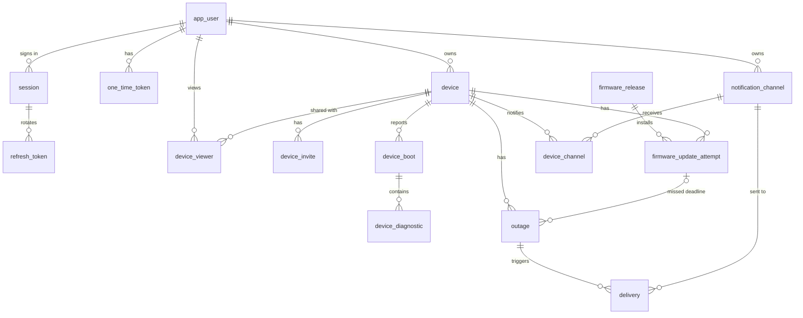

# Electricity Monitor — Database schema (v2)

The source of truth for the PostgreSQL schema: tables, columns, constraints,
indexes, and how the API and worker use them. Product behaviour is in
[PROJECT_V2.md](PROJECT_V2.md), endpoints and payloads in [API.md](API.md).
Drizzle schema files and Drizzle Kit migrations in `server/` follow this
document. Update it when a table changes.

Design rules follow the `supabase-postgres-best-practices` skill.

## 1. Conventions

- **Names:** lowercase `snake_case` tables and columns. A table is named
  after its entity, in the singular: `device`, `device_invite`, `outage`.
  `user` is a reserved word in Postgres, so the users table is `app_user`.
  Its foreign keys are still called `user_id`. Configure Drizzle with
  `casing: "snake_case"`, so the database never needs quoted identifiers.
- **IDs:** `uuid` primary keys for every resource the API exposes (API.md
  uses UUID strings). Generate **UUIDv7** (time-ordered) so inserts stay
  at the end of the index. Avoid random v4 keys. The server generates
  them (Drizzle `$defaultFn`), so the schema works on any Postgres
  version. Join tables and natural
  keys use composite primary keys. Token tables use the token hash as the
  key.
- **Time:** always `timestamptz`, stored in UTC. Local times without a date
  (quiet hours) use `time`.
- **Durations:** `integer` seconds, columns end with `_s`, same as the API.
- **Enums:** values are `UPPER_CASE`, the same in the database, the API
  and the spec (`ONLINE`, `POWER`, `POWER_BLIP`). Two kinds:
  - **Native enum types** (Drizzle `pgEnum`) for value lists fixed by the
    domain model or the device protocol. Values may be added but are not
    expected to be removed. See [Enum types](#enum-types).
  - **`text` with a `check (... in (...))` constraint** for workflow
    statuses and configuration lists that may be reshaped, e.g.
    `delivery.status`, `notification_channel.type` (Viber is planned) and
    `one_time_token.purpose`. Removing a value from a native enum needs a
    new type and a column conversion. A check constraint is simply
    replaced.
  - Standard values keep their own spelling and stay `text` + `check`:
    language codes (`uk`) and webhook event names (`device.offline`).
- **Strings:** `text`. Length limits live in the Zod schemas. The database
  only rejects blanks where it matters.
- **Emails:** stored lowercased by the server. `check (email = lower(email))`
  keeps a plain unique index correct.
- **Secrets:** tokens are never stored. Store only the SHA-256 hash as
  `bytea` (32 bytes). Bot tokens and webhook secrets are encrypted with
  AES-256-GCM and stored as one `bytea` value: `nonce || ciphertext || tag`.
- **Foreign keys:** every FK column is indexed (alone or as the leading
  column of another index), so joins and `on delete cascade` don't scan
  the child table. A partial index counts only when its condition is
  `<column> is not null`, since cascades look up every non-null value.
- **`updated_at`:** set by the server on write (Drizzle `$onUpdate`), no
  triggers.
- **Constraint names:** the SQL below leaves checks unnamed for reading.
  The Drizzle schema names them `<table>_<what>_check` and column unique
  constraints `<table>_<column>_key`, because Drizzle requires names.
- **Descending indexes** are `desc nulls first`, the Postgres default for
  `order by … desc`, so keyset queries can use them. Drizzle needs
  `.desc().nullsFirst()` for this; plain `.desc()` emits `nulls last`.

### Enum types

```sql
create type device_state    as enum ('PENDING', 'ONLINE', 'OFFLINE', 'UPDATING');
create type reset_reason    as enum ('POWER_ON', 'BROWNOUT', 'SOFTWARE', 'WATCHDOG', 'PANIC', 'UNKNOWN');
create type diagnostic_kind as enum ('WIFI', 'API');
create type outage_type     as enum ('OUTAGE', 'POWER_BLIP');
create type outage_cause    as enum ('POWER', 'NETWORK', 'UNKNOWN');
create type outage_kind     as enum ('SHORT', 'LONG');
create type update_outcome  as enum ('SUCCEEDED', 'FAILED', 'ROLLED_BACK');
```

| Type              | Used by                                   |
| ----------------- | ----------------------------------------- |
| `device_state`    | `device.state`                            |
| `reset_reason`    | `device_boot.reset_reason`, check-in body |
| `diagnostic_kind` | `device_diagnostic.kind`                  |
| `outage_type`     | `outage.type`                             |
| `outage_cause`    | `outage.cause`                            |
| `outage_kind`     | `outage.kind`                             |
| `update_outcome`  | `firmware_update_attempt.outcome`         |

Type names never match a table name, because every table also creates a
row type with its own name.

## 2. Overview



| Group               | Tables                                                   |
| ------------------- | -------------------------------------------------------- |
| Accounts and auth   | `app_user`, `session`, `refresh_token`, `one_time_token` |
| Devices and sharing | `device`, `device_viewer`, `device_invite`               |
| Firmware and OTA    | `firmware_release`, `firmware_update_attempt`            |
| Monitoring history  | `device_boot`, `device_diagnostic`, `outage`             |
| Notifications       | `notification_channel`, `device_channel`, `delivery`     |
| Platform            | `worker_heartbeat`                                       |

## 3. Accounts and auth

### `app_user`

```sql
create table app_user (
  id                uuid primary key,
  email             text unique check (email = lower(email)),
  email_verified_at timestamptz,
  phone             text unique,
  phone_verified_at timestamptz,
  telegram_user_id  bigint unique,
  password_hash     text,
  google_sub        text unique,
  name              text not null,
  language          text not null default 'uk' check (language in ('uk', 'en', 'ru')),
  timezone          text not null default 'Europe/Kyiv',
  is_admin          boolean not null default false,
  created_at        timestamptz not null default now(),
  updated_at        timestamptz not null default now(),
  check (password_hash is not null or google_sub is not null),
  check (email is not null or phone is not null)
);
```

- `password_hash` is argon2id. `null` means a Google-only account.
- Every account has an email or a phone. `phone` is E.164
  (`+380501234567`), normalized by the server.
- `telegram_user_id` is the Telegram user who confirmed the phone. The bot
  writes to that user (a private chat ID equals the user ID).
- `google_sub` is the Google account ID (OIDC `sub`). The sign-in method
  check stops unlinking the only sign-in method
  (`DELETE /api/auth/google` → `409`).
- `has_password`, `google_linked`, `email_verified` and `phone_verified`
  in `GET /me` are derived from these columns.
- `timezone` is an IANA name, validated by the server.

### `session`

One row per sign-in. A refresh token family belongs to one session.

```sql
create table session (
  id           uuid primary key,
  user_id      uuid not null references app_user (id) on delete cascade,
  created_at   timestamptz not null default now(),
  last_used_at timestamptz not null default now(),
  revoked_at   timestamptz
);

create index session_user_id_idx on session (user_id);
```

- `created_at` is the sign-in time. `DELETE /me` for Google-only accounts
  checks it for the current session (the JWT carries the session ID).
- Log out, log out everywhere, password reset and refresh token reuse set
  `revoked_at`.

### `refresh_token`

```sql
create table refresh_token (
  token_hash bytea primary key check (octet_length(token_hash) = 32),
  session_id uuid not null references session (id) on delete cascade,
  expires_at timestamptz not null,
  used_at    timestamptz,
  created_at timestamptz not null default now()
);

create index refresh_token_session_id_idx on refresh_token (session_id);
```

- Refresh: lock the presented token row (`for update`). If it is unused,
  valid, and the session is not revoked, set `used_at` and insert the next
  token in the same transaction.
- A token with `used_at` set means reuse. If `used_at` is within 10 s the
  API answers `409` and changes nothing (a parallel refresh); older than
  that, revoke the whole session.

### `one_time_token`

Email verification, password reset, the platform Telegram link code and
the phone codes.

```sql
create table one_time_token (
  token_hash       bytea primary key check (octet_length(token_hash) = 32),
  user_id          uuid not null references app_user (id) on delete cascade,
  purpose          text not null check (purpose in
                     ('VERIFY_EMAIL', 'RESET_PASSWORD', 'TELEGRAM_LINK',
                      'PHONE_VERIFY', 'PHONE_RECOVER')),
  email            text check (email = lower(email)),
  phone            text,
  telegram_user_id bigint,
  expires_at       timestamptz not null,
  used_at          timestamptz,
  created_at       timestamptz not null default now()
);

create index one_time_token_user_id_idx on one_time_token (user_id, purpose);
create index one_time_token_telegram_user_idx on one_time_token (telegram_user_id)
  where used_at is null;
```

- Lifetimes: `VERIFY_EMAIL` 24 h, `RESET_PASSWORD` 1 h, `TELEGRAM_LINK`
  15 min, `PHONE_VERIFY` 24 h, `PHONE_RECOVER` 1 h.
- `email` is set on a `VERIFY_EMAIL` token for an email added to an
  existing account; the account gets it only when the link is used.
  `phone` is the number the token is about. `telegram_user_id` is who
  opened a phone code in the bot.
- A used or expired token returns `410 expired`, so rows stay until cleanup
  (§10).

## 4. Devices and sharing

### `device`

Identity, credentials, live monitoring state and settings. The check-in,
OTA and worker handlers lock this row (`for update`) before writing state,
outages or queue entries.

```sql
create table device (
  id                       uuid primary key,
  owner_id                 uuid not null references app_user (id) on delete cascade,
  name                     text not null check (name <> ''),

  token_hash               bytea unique check (octet_length(token_hash) = 32),
  pairing_code_hash        bytea unique check (octet_length(pairing_code_hash) = 32),
  pairing_code_expires_at  timestamptz,
  claimed_at               timestamptz,

  state                    device_state not null default 'PENDING',
  state_since              timestamptz not null default now(),
  last_seen_at             timestamptz,
  offline_at               timestamptz,
  boot_id                  uuid,
  seq                      integer,
  uptime_s                 integer,
  rssi                     smallint,
  fw_version               text,

  ping_interval_s          integer not null default 20,
  previous_ping_interval_s integer,
  offline_timeout_s        integer not null default 40,
  short_outage_threshold_s integer not null default 180,
  notify_short_outages     boolean not null default true,
  notify_network_outages   boolean not null default true,
  quiet_hours_start        time,
  quiet_hours_end          time,
  auto_update              boolean not null default false,
  settings_version         integer not null default 1,
  applied_settings_version integer,

  created_at               timestamptz not null default now(),
  updated_at               timestamptz not null default now(),

  check (ping_interval_s >= 5),
  check (offline_timeout_s >= 2 * ping_interval_s),
  check (short_outage_threshold_s > 0),
  check ((quiet_hours_start is null) = (quiet_hours_end is null)),
  check ((pairing_code_hash is null) = (pairing_code_expires_at is null)),
  check ((state = 'ONLINE') = (offline_at is not null)),
  check (applied_settings_version <= settings_version)
);

create index device_owner_id_idx on device (owner_id);
create index device_offline_at_idx on device (offline_at) where state = 'ONLINE';
```

- **Credentials.** `token_hash` is `null` before the first claim and after
  `rotate-token`. One pairing code per device, so a new code replaces the
  old one. Claiming sets `token_hash` and `claimed_at`, clears the pairing
  code columns, `boot_id`, `seq` and `previous_ping_interval_s`, and sets
  `applied_settings_version = settings_version` (the claim response carries
  the settings).
- **Live state.** `boot_id`, `seq`, `uptime_s`, `rssi` and `fw_version`
  come from the last accepted check-in. A check-in with the same `boot_id`
  and `seq <= device.seq` is a duplicate. The reset reason is read from
  `device_boot`.
- **`offline_at`** is when the worker should mark an `ONLINE` device
  `OFFLINE`: the later of `last_seen_at` and the OTA result time, plus
  `offline_timeout_s`, allowing for `previous_ping_interval_s` until the
  device applies new settings. Every accepted check-in rewrites it. The
  worker reads it through the small partial index instead of computing a
  deadline per row.
- **Settings sync.** Changing `ping_interval_s` increments
  `settings_version` and keeps the old value in `previous_ping_interval_s`
  (the larger one if it is changed again before the device applies it).
  While it is set, `offline_at` is
  `last_seen_at + max(offline_timeout_s, 2 × previous_ping_interval_s)`.
  A settings change on an `ONLINE` device recomputes `offline_at` at once.
  When the device reports the version as applied, set
  `applied_settings_version` and clear `previous_ping_interval_s`.
- **Notification rules** (`notify_*`, quiet hours) sit on the device and
  apply to every recipient. Quiet hours are evaluated in the recipient's
  timezone (§12, question 1).

### `device_viewer`

The owner is `device.owner_id`, so "one owner per device" holds by
design. This table holds viewers only.

```sql
create table device_viewer (
  device_id  uuid not null references device (id) on delete cascade,
  user_id    uuid not null references app_user (id) on delete cascade,
  created_at timestamptz not null default now(),
  primary key (device_id, user_id)
);

create index device_viewer_user_id_idx on device_viewer (user_id);
```

- `GET /devices` = devices where `owner_id = $user` plus devices joined
  through `device_viewer` for `$user`.
- Removing a viewer also deletes their rows in `device_channel` for that
  device, in the same transaction.

### `device_invite`

```sql
create table device_invite (
  id          uuid primary key,
  device_id   uuid not null references device (id) on delete cascade,
  email       text check (email = lower(email)),
  phone       text,
  invited_by  uuid not null references app_user (id) on delete cascade,
  token_hash  bytea not null unique check (octet_length(token_hash) = 32),
  expires_at  timestamptz not null,
  accepted_at timestamptz,
  created_at  timestamptz not null default now(),
  check (num_nonnulls(email, phone) = 1)
);

create unique index device_invite_pending_key on device_invite (device_id, email)
  where accepted_at is null;
create unique index device_invite_pending_phone_key on device_invite (device_id, phone)
  where accepted_at is null;
create index device_invite_device_id_idx on device_invite (device_id);
create index device_invite_invited_by_idx on device_invite (invited_by);
```

- Inviting the same email again upserts the pending invite with a new
  token and expiry (`on conflict (device_id, email) where accepted_at is null`).
- Accept sets `accepted_at` and inserts the viewer in one transaction. An
  accepted or expired token returns `410`. Revoke deletes the row.

## 5. Firmware and OTA

### `firmware_release`

```sql
create table firmware_release (
  id           uuid primary key,
  version      text not null unique,
  version_code integer not null unique,
  channel      text not null default 'STABLE' check (channel in ('STABLE', 'BETA')),
  size_bytes   integer not null check (size_bytes > 0),
  sha256       bytea not null check (octet_length(sha256) = 32),
  signature    bytea not null,
  image_path   text not null,
  published_at timestamptz,
  created_at   timestamptz not null default now()
);
```

- `version` is the display string (`2.1.0`). `version_code` increases with
  every release and gives a reliable order for "latest", which sorting
  `text` versions does not.
- `published_at` `null` is a draft. Automatic OTA offers only published
  `STABLE` releases.
- `image_path` is the release folder `<version>` in the environment's
  private `firmware` Storage bucket. It holds `app.bin` (OTA) and
  `factory.bin` (browser flashing). `size_bytes` and `sha256` describe
  `app.bin`.

### `firmware_update_attempt`

One row per install attempt. `id` is the `attempt_id` in the API.

```sql
create table firmware_update_attempt (
  id              uuid primary key,
  device_id       uuid not null references device (id) on delete cascade,
  release_id      uuid not null references firmware_release (id),
  requested_by    uuid references app_user (id) on delete set null,
  status          text not null default 'QUEUED'
                    check (status in ('QUEUED', 'INSTALLING', 'FINISHED', 'TIMED_OUT', 'CANCELLED')),
  start_boot_id   uuid,
  started_at      timestamptz,
  window_ends_at  timestamptz,
  outcome         update_outcome,
  running_version text,
  result_boot_id  uuid,
  finished_at     timestamptz,
  created_at      timestamptz not null default now(),
  check (status in ('QUEUED', 'CANCELLED') or (started_at is not null and window_ends_at is not null)),
  check (status <> 'QUEUED' or started_at is null),
  check ((outcome is null) = (finished_at is null)),
  check (status <> 'FINISHED' or outcome is not null)
);

create index firmware_update_attempt_device_idx on firmware_update_attempt (device_id, created_at desc);
create unique index firmware_update_attempt_one_active on firmware_update_attempt (device_id)
  where status in ('QUEUED', 'INSTALLING');
create index firmware_update_attempt_window_idx on firmware_update_attempt (window_ends_at)
  where status = 'INSTALLING';
create index firmware_update_attempt_release_id_idx on firmware_update_attempt (release_id);
create index firmware_update_attempt_requested_by_idx on firmware_update_attempt (requested_by)
  where requested_by is not null;
```

- `requested_by` `null` means automatic OTA offered the release.
- At most one queued or installing attempt per device (partial unique
  index). `POST /devices/:id/firmware-update` gets `409` from it.
- `update_started` sets `INSTALLING`, `started_at`, `start_boot_id` and
  `window_ends_at`. Retries return the stored deadline.
- `update_finished` before the deadline sets `FINISHED`, `outcome`,
  `running_version`, `result_boot_id` and `finished_at`. A late result
  keeps `TIMED_OUT` and fills in the outcome columns.
- Automatic OTA skips a release that has a `FAILED`, `ROLLED_BACK` or
  `TIMED_OUT` attempt for this device, unless a newer explicit attempt
  exists.
- A release cannot be deleted while attempts reference it (default
  `no action`).

## 6. Monitoring history

### `device_boot`

One row per boot session the server has seen.

```sql
create table device_boot (
  device_id     uuid not null references device (id) on delete cascade,
  boot_id       uuid not null,
  reset_reason  reset_reason not null,
  wifi_evicted  integer not null default 0,
  first_seen_at timestamptz not null default now(),
  primary key (device_id, boot_id)
);
```

- Upserted on the first check-in of a boot (`on conflict do nothing`).
- `wifi_evicted` keeps the highest eviction counter reported in this boot:
  `do update set wifi_evicted = excluded.wifi_evicted where excluded.wifi_evicted > device_boot.wifi_evicted`.

### `device_diagnostic`

Wi-Fi disconnects and API reachability failures reported by the device.

```sql
create table device_diagnostic (
  device_id      uuid not null,
  boot_id        uuid not null,
  local_id       integer not null,
  kind           diagnostic_kind not null,
  reason         smallint,
  start_uptime_s integer not null,
  end_uptime_s   integer not null,
  started_at     timestamptz not null,
  ended_at       timestamptz not null,
  received_at    timestamptz not null default now(),
  primary key (device_id, boot_id, local_id),
  foreign key (device_id, boot_id) references device_boot (device_id, boot_id) on delete cascade,
  check (end_uptime_s >= start_uptime_s),
  check (kind = 'WIFI' or reason is null)
);

create index device_diagnostic_device_started_idx on device_diagnostic (device_id, started_at desc);
```

- The primary key is the dedupe key from the spec: device, boot ID and
  local event ID. Insert with `on conflict do nothing`, so retried pings
  never duplicate records.
- `started_at` and `ended_at` are estimates: the check-in time minus the
  uptime difference. They let the recovery handler find a disconnect that
  overlaps an outage gap and confirm a `NETWORK` cause.
- `reason` is the Wi-Fi driver reason code, `null` for `API` records.

### `outage`

Outages and suspected power blips, open and closed.

```sql
create table outage (
  id                  uuid primary key,
  device_id           uuid not null references device (id) on delete cascade,
  type                outage_type not null,
  started_at          timestamptz not null,
  ended_at            timestamptz,
  duration_s          integer generated always as (extract(epoch from ended_at - started_at)::integer) stored,
  cause               outage_cause,
  kind                outage_kind,
  ota_attempt_id      uuid references firmware_update_attempt (id) on delete set null,
  off_alert_due_at    timestamptz,
  off_alert_queued_at timestamptz,
  created_at          timestamptz not null default now(),
  check (ended_at is null or ended_at >= started_at),
  check ((ended_at is null) = (cause is null) and (ended_at is null) = (kind is null)),
  check (type = 'OUTAGE' or (ended_at is not null and off_alert_due_at is null))
);

create index outage_device_started_idx on outage (device_id, started_at desc, id desc);
create unique index outage_one_open_per_device on outage (device_id) where ended_at is null;
create index outage_off_alert_due_idx on outage (off_alert_due_at)
  where ended_at is null and off_alert_queued_at is null;
create index outage_ota_attempt_id_idx on outage (ota_attempt_id) where ota_attempt_id is not null;
```

- `started_at` is the last accepted check-in before the interruption, or
  the OTA deadline for a missed window. `ended_at` is the recovery
  check-in. `duration_s` is the observed contact gap.
- `cause` and `kind` are set when the outage closes. A power blip is
  inserted already closed.
- Only one open outage per device (partial unique index).
- **OFF alerts.** When the worker opens an outage it sets
  `off_alert_due_at`: right away if the device notifies on short outages,
  otherwise after the short-outage threshold as well (never earlier than
  the moment the outage opens). The worker queues
  deliveries when the time comes and sets `off_alert_queued_at`. On
  recovery, `off_alert_queued_at is null` means no OFF alert went out, so
  send at most one summary (PROJECT_V2 §5).
- Planned OTA windows create no rows, so statistics exclude them without
  extra filtering.
- Volume: a few rows per device per day, about 2 M rows a year at 1 000
  devices. No partitioning needed (the skill suggests it above ~100 M rows).

## 7. Notifications

### `notification_channel`

Type-specific columns with one check per type, instead of `jsonb`, so the
database rejects incomplete channels.

```sql
create table notification_channel (
  id                     uuid primary key,
  user_id                uuid not null references app_user (id) on delete cascade,
  type                   text not null check (type in ('TELEGRAM_PLATFORM', 'TELEGRAM_BOT', 'WEBHOOK')),
  name                   text not null,
  enabled                boolean not null default true,
  disabled_reason        text check (disabled_reason in ('USER', 'TOO_MANY_FAILURES')),
  consecutive_failures   integer not null default 0,
  telegram_chat_id       bigint,
  telegram_bot_token_enc bytea,
  webhook_url            text,
  webhook_events         text[],
  webhook_secret_enc     bytea,
  created_at             timestamptz not null default now(),
  updated_at             timestamptz not null default now(),
  check (enabled = (disabled_reason is null)),
  check (
    (type = 'TELEGRAM_PLATFORM'
      and telegram_chat_id is not null
      and num_nonnulls(telegram_bot_token_enc, webhook_url, webhook_events, webhook_secret_enc) = 0)
    or (type = 'TELEGRAM_BOT'
      and num_nonnulls(telegram_chat_id, telegram_bot_token_enc) = 2
      and num_nonnulls(webhook_url, webhook_events, webhook_secret_enc) = 0)
    or (type = 'WEBHOOK'
      and num_nonnulls(webhook_url, webhook_events, webhook_secret_enc) = 3
      and num_nonnulls(telegram_chat_id, telegram_bot_token_enc) = 0)
  ),
  check (cardinality(webhook_events) > 0
    and webhook_events <@ array['device.offline', 'device.online', 'device.power_blip'])
);

create index notification_channel_user_id_idx on notification_channel (user_id);
create unique index notification_channel_platform_chat_key on notification_channel (user_id, telegram_chat_id)
  where type = 'TELEGRAM_PLATFORM';
create index notification_channel_platform_chat_idx on notification_channel (telegram_chat_id)
  where type = 'TELEGRAM_PLATFORM';
```

- Telegram chat IDs fit in `bigint`. The API shows them as strings.
- The platform bot finds the linked users for `/status`, `/stats` and
  `/stop` by `telegram_chat_id`. Several users can link the same group.
- Each delivery failure increments `consecutive_failures`. At 20 the worker
  disables the channel with `TOO_MANY_FAILURES`. Success or re-enabling
  resets it to 0.

### `device_channel`

Which of a user's channels a device notifies.

```sql
create table device_channel (
  device_id  uuid not null references device (id) on delete cascade,
  channel_id uuid not null references notification_channel (id) on delete cascade,
  created_at timestamptz not null default now(),
  primary key (device_id, channel_id)
);

create index device_channel_channel_id_idx on device_channel (channel_id);
```

- The server allows linking only the caller's own channels to a device the
  caller owns or views. `PUT /devices/:id/channels` replaces only the
  caller's rows.

### `delivery`

The notification queue and the delivery log in one table. The `id` is the
`X-Elec-Delivery` header and stays the same across retries and redelivery.

```sql
create table delivery (
  id              uuid primary key,
  outage_id       uuid not null references outage (id) on delete cascade,
  channel_id      uuid not null references notification_channel (id) on delete cascade,
  event           text not null check (event in ('device.offline', 'device.online', 'device.power_blip')),
  payload         jsonb not null,
  status          text not null default 'QUEUED' check (status in ('QUEUED', 'SENT', 'RETRYING', 'FAILED')),
  attempts        smallint not null default 0,
  next_attempt_at timestamptz not null default now(),
  last_attempt_at timestamptz,
  last_error      text,
  sent_at         timestamptz,
  created_at      timestamptz not null default now()
);

create unique index delivery_once_per_event on delivery (outage_id, channel_id, event);
create index delivery_channel_created_idx on delivery (channel_id, created_at desc, id desc);
create index delivery_due_idx on delivery (next_attempt_at) where status in ('QUEUED', 'RETRYING');
```

- Every event belongs to an outage or power blip, so `outage_id` is
  required. The device comes from the outage.
- The unique index enforces "one notification per event and channel".
  Queue with `on conflict do nothing`, so a retried check-in or OTA
  result can't send twice.
- Rows are inserted in the same transaction as the state change.
- `payload` is a snapshot of the machine-readable event:
  `{ event, device: { id, name }, outage: <outage item> }`. Fan-out sends
  only to enabled channels whose user can read the device, and for
  webhooks only when the event is in `webhook_events`. Webhook retries resend the same body. Telegram text is
  rendered at send time in the recipient's language and timezone, with
  quiet hours applied.
- Retries: 1 min, 5 min, 30 min, 2 h, 6 h, then `FAILED` (6 attempts).
  Redeliver sets `QUEUED` and `next_attempt_at = now()` on the same row.
- **Platform bot outcomes.** `2xx` → `SENT`. `429` → `RETRYING` at
  Telegram's `retry_after`, and the attempt isn't counted. `400` / `403`
  → `FAILED` at once and `consecutive_failures + 1`. `5xx`, network errors
  and the 10 s timeout follow the retry schedule and don't touch
  `consecutive_failures`, so a Telegram outage can't disable channels. A
  `migrate_to_chat_id` reply updates `telegram_chat_id` and retries at
  once. Channels disable at 20 counted failures.
- **Skipped sends.** A delivery whose channel's user can no longer read the device (a removed viewer) becomes `FAILED` with `last_error = 'skipped: no access'`. A `device.offline` delivery whose outage has closed, or whose channel is disabled, becomes `FAILED` with `skipped: outage closed` or `skipped: channel disabled`. The failure counter is unchanged.
- **Send loop.** The worker claims up to 30 due rows, sends rows of one
  channel in order, runs up to 10 channels at once, and takes a token from
  a 30 messages/s pacer before every send. It beats `worker_heartbeat`
  under the name `delivery`.
- Emails (verification, reset, invites, "webhook disabled") go straight to
  Resend and are not stored here.

## 8. Platform

### `worker_heartbeat`

```sql
create table worker_heartbeat (
  worker      text primary key,
  instance_id text not null,
  beat_at     timestamptz not null
);
```

The worker upserts its row on every loop. The admin health endpoint
reads `beat_at`.

### `rate_limit_bucket`

```sql
create table rate_limit_bucket (
  key          text primary key,
  window_start timestamptz not null,
  count        integer not null
);

create index rate_limit_bucket_window_start_idx on rate_limit_bucket (window_start);
```

Fixed-window rate limit counters shared by all API instances. `key` is
`<rule name>:<ip|email|user>:<SHA-256 hex of the value>`, so no raw email
or IP address is stored. One upsert per request; a hit in a new window
resets `count` to 1. The worker deletes rows older than one day.

### Not stored in the database

- Google OAuth `state` and PKCE verifier: short-lived signed `httpOnly`
  cookie.
- Access JWTs, translations, API error metrics (logs).
- Firmware images (§12, question 3).

## 9. Hot paths

Each query states the index it relies on.

| Path                      | Query shape                                                                                                                 | Index                                              |
| ------------------------- | --------------------------------------------------------------------------------------------------------------------------- | -------------------------------------------------- |
| Device check-in           | `select … from device where token_hash = $1 for update`                                                                     | `device.token_hash` unique                         |
| Offline check (every 2 s) | `select id from device where state = 'ONLINE' and offline_at <= now() order by offline_at limit 100 for update skip locked` | `device_offline_at_idx`                            |
| OTA deadline check        | `firmware_update_attempt where status = 'INSTALLING' and window_ends_at <= now()`, then lock the device                     | `firmware_update_attempt_window_idx`               |
| Due OFF alerts            | `outage where ended_at is null and off_alert_queued_at is null and off_alert_due_at <= now()`                               | `outage_off_alert_due_idx`                         |
| Delivery queue            | `delivery where status in ('QUEUED', 'RETRYING') and next_attempt_at <= now() … for update skip locked`                     | `delivery_due_idx`                                 |
| My devices                | `device where owner_id = $1` + `device_viewer where user_id = $1`                                                           | `device_owner_id_idx`, `device_viewer_user_id_idx` |
| Outage history            | `where device_id = $1 and (started_at, id) < ($cursor) order by started_at desc, id desc limit $n`                          | `outage_device_started_idx`                        |
| Stats                     | `where device_id = $1 and started_at < $to and (ended_at is null or ended_at > $from)`                                      | `outage_device_started_idx`                        |
| Delivery log              | `where channel_id = $1 and (created_at, id) < ($cursor) order by created_at desc, id desc`                                  | `delivery_channel_created_idx`                     |

- **Lock order.** Always lock the `device` row first, then outages,
  attempts and deliveries. Check-in, OTA and worker handlers all follow it,
  which prevents deadlocks.
- **Worker locks.** The worker uses `for update skip locked`, so it skips
  devices a check-in is processing right now and picks them up on the next
  run. After taking the lock it re-checks the condition.
- **Short transactions.** No HTTP, Telegram or Resend calls inside a
  transaction. The delivery worker claims a batch in a short transaction
  (`attempts + 1`, `next_attempt_at = now() + 2 min` as a lease), commits,
  sends, then writes the result. A crashed worker's rows become due again
  when the lease ends.
- **Pagination.** Keyset (cursor) everywhere, never `offset`. The opaque API
  cursor encodes the last row's sort columns.
- **Stats** are computed from `outage` on request. At this scale no rollup
  tables are needed. Day and week buckets use the caller's timezone.
- **Connections.** Use the Supabase transaction pooler (port 6543). Turn off
  prepared statements in the driver (`prepare: false` in postgres.js) and
  avoid session state (`set`, session advisory locks, `listen`). Set a
  `statement_timeout` for the app role.
- **Write load.** Each ping is one `update` of one `device` row (about
  33/s at 1 000 devices). Watch autovacuum on `device` and `delivery`
  as the fleet grows.

## 10. Security and retention

### Access

- Enable Row Level Security on every table and create **no policies**, so
  the Supabase `anon` and `authenticated` roles read nothing (PROJECT_V2
  §10). Migration `0001_revoke_public_roles` also revokes their table
  privileges in `public` and the matching default privileges.
- The API and worker connect as the table owner, which bypasses RLS. Do
  **not** use `force row level security`. With no policies it would block
  our own server.
- Owner and viewer access is enforced in server queries. Tests check that
  user A can't read user B's rows.

### Account and device deletion

Cascades implement the spec without extra code:

- Deleting a user removes their sessions, tokens, owned devices, viewer
  memberships, channels and, through devices and channels, their outages,
  attempts, diagnostics, invites and deliveries.
- Deleting a device removes its outages, viewers, invites, channel links,
  boots, diagnostics, attempts and queued deliveries.

### Cleanup (worker, daily)

| Data                            | Rule                                                                                   |
| ------------------------------- | -------------------------------------------------------------------------------------- |
| `one_time_token`                | Delete one day after `expires_at`                                                      |
| `session`                       | Delete when revoked or when every refresh token has expired (cascades `refresh_token`) |
| `device_invite`                 | Delete 30 days after `expires_at`                                                      |
| `rate_limit_bucket`             | Delete when `window_start` is older than one day (worker, every tick)                  |
| `delivery`, `device_diagnostic` | Delete after 90 days (`delivery.created_at`, `device_diagnostic.started_at`)           |
| `outage`, `device_boot`         | Keep (history and statistics)                                                          |

## 11. Migrations

- Drizzle Kit generates SQL migrations in `server/` from the Drizzle schema.
  Review the SQL before merge. Run migrations once per environment before
  the API and worker roll forward.
- Keep migrations compatible with the running version during a rolling
  deploy: add columns as nullable or with a default, and remove a column
  only after no running code reads it.
- Adding a value is safe for old code in both enum kinds:
  - Native enum: `alter type ... add value`. The new value can't be used
    in the same transaction, so add it in its own migration before any
    migration or code uses it. Removing a value means creating a new type,
    converting the columns and dropping the old type. Avoid it.
  - `text` + `check`: replace the constraint. Use `not valid`, then
    `validate constraint`, to avoid a long lock on big tables.
- Create indexes on large existing tables with `create index concurrently`
  in a separate migration (it cannot run inside a transaction).
- Postgres has no `add constraint if not exists`. Hand-written migrations
  that must be idempotent check `pg_constraint` first.

## 12. Open questions

1. ~~**Notification rules for viewers.**~~ ✅ Resolved: the rules stay on
   the device and the owner sets them for every recipient. Quiet hours
   are evaluated in the recipient's timezone.
2. ~~**Retention** for `delivery` and `device_diagnostic`.~~ ✅ Resolved: 90 days.
3. ~~**Firmware storage**~~ ✅ Resolved: a private Supabase Storage bucket
   per environment, `image_path` is the version folder (§5). Every newer
   published `STABLE` release is compatible (one board type), so there is
   no compatibility column.
4. ~~**Rate limit counters.**~~ ✅ Resolved: Postgres table `rate_limit_bucket` (§8).
5. **API.md gap.** `update.status` in API.md lists `QUEUED`, `INSTALLING`,
   `FINISHED`, `TIMED_OUT`, but `POST /device/updates/:id/start` returns
   `409` for a cancelled attempt. This schema adds `CANCELLED`. API.md
   should list it too.
