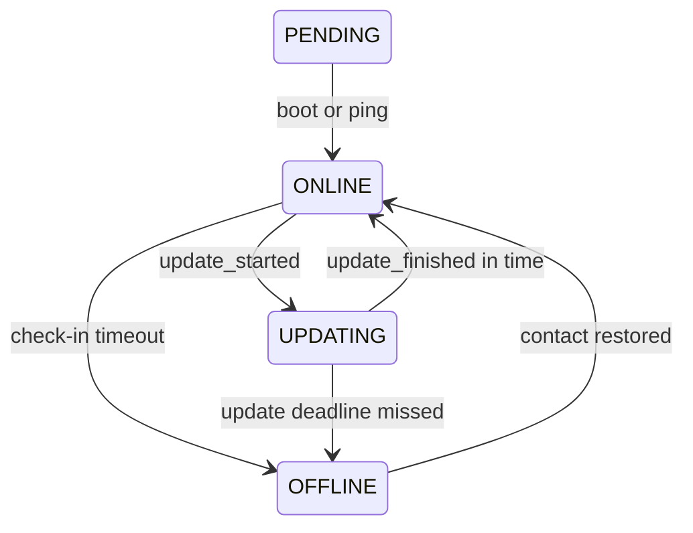

# Electricity Monitor — Project Spec (v2: multi-user platform)

## 1. Goal

Turn [v1](archived/PROJECT_V1.md) into a platform for many users.

Anyone can buy a pre-flashed device from us, or buy their own ESP32-C3
and flash our firmware. They connect it to their home Wi-Fi and get
alerts when their device loses and restores contact. Advanced users get a REST
API, webhooks and more control. All Telegram alerts come from our
platform bot; users don't connect their own bots.

The device pings every 20 s by default. Missing pings indicate a loss of
contact. The device also checks in immediately after boot, as soon as it
can reach the API. The server uses boot information to estimate the cause
of a gap and can record a suspected power blip even if the device never
went offline.

The platform is **free** for all users for now.

## 2. Scope

### In v2

- Own auth: email + password and Google sign-in. Emails sent via
  Resend.
- Many devices per user, each with its own token and settings.
- Sharing a device with family members.
- Easy device setup: pre-flashed device or browser flashing, then Wi-Fi
  and pairing code on the device's own setup page.
- Notifications:
  - Telegram via the **platform bot** (simple, default),
  - **Webhooks** (signed, with retries).
- **REST API** with Swagger UI backed by a generated OpenAPI document.
- Outage classification:
  - **short** vs **long** interruption, threshold adjustable per device,
  - suspected **power** loss, a **network** interruption, or an **unknown**
    cause, based on boot information and uptime.
- Statistics: number of outages, total / average downtime, availability
  % per day / week / month.
- Separate React apps for users and platform administrators.
- Remote device settings and signed firmware updates over Wi-Fi (OTA).
- Ukrainian, English and Russian translations stored by key in the repo.

### Architecture

- The React client, React admin app, ESP devices and external integrations
  connect to one Node.js/Express API. The API enforces access for each caller.
- PostgreSQL stores accounts, device ownership and sharing, device state and
  settings, outage history, update status and the notification queue.
  [DATABASE.md](DATABASE.md) defines the schema.
- A separate worker uses the same database to detect missed pings, check
  update deadlines and deliver notifications. React apps and devices access
  platform data through the API.

## 3. Auth (custom)

Implemented in our Express server. No third-party auth service; Resend
only sends emails.

### Email + password

- Sign up → verification email (Resend) with a one-time link (valid
  24 h). Account can't add devices until the email is verified. Sign up
  answers `201` with no body and does not sign in: signing in would reveal
  whether the email was new. An existing email gets an "account exists"
  email instead.
- Emails are sent after the response, so response time doesn't reveal
  whether an account exists. A lost email is recovered with resend or
  forgot password.
- Verifying the email also accepts pending device invites for it (§6).
- Every bad email-link token answers `410 expired`, whether it is unknown,
  used, expired or for another purpose.
- Passwords hashed with **argon2id**.
- Forgot password → reset link by email (valid 1 h, single use). Reset
  logs out all sessions, marks the email verified (the link proves ownership)
  and expires the user's other unused reset links.
- Rate limits on sign up, log in, reset (per IP and per email).

### Phone + password

- A user picks an email or a mobile phone as the identifier. Phones are
  stored as E.164; each phone and email belongs to one account at most.
- Forms take the identifier in one "Email or phone" field. A phone is
  recognised as it is typed: a country picker (flag and dialing code,
  default Ukraine) appears and the number formats live. The client sends
  E.164.
- Sign up, log in and forgot password work with a phone. The number is
  confirmed once, by sharing the contact with the platform Telegram bot
  (§7). No SMS.
- Sign up and forgot password always answer with a Telegram link, so they
  don't reveal whether a number has an account. For an existing number the
  link recovers the account: sharing the matching contact sends a password
  reset link (valid 1 h).
- Once a Telegram user is bound, the bot writes on its own: reset links and
  "someone tried to sign up" notices.
- Resetting through a phone link verifies the phone and logs out all
  sessions.
- A signed-in user can add the missing identifier: a phone to an email
  account, an email to a phone account (also by linking Google). The account
  must already be verified. Identifiers can't be changed or removed.
- An added email or phone is set on the account only once it is confirmed
  (the email link or the bot). Only a confirmed number blocks other
  accounts: when its real owner confirms a number that an unconfirmed
  account holds, that account loses it (and is deleted if it has no other
  identifier).
- The bot's confirmation request warns the user to share the number only if
  they opened the link themselves, because a forwarded link would bind
  their number to the sender's account.
- Linking Google needs a verified account. A password reset that verifies
  an account for the first time also unlinks Google.
- Rate limits per phone match those per email.

### Google sign-in

- OAuth 2.0 / OpenID Connect, authorization code flow with PKCE.
- Scopes `openid email profile`. The ID token arrives over the TLS back
  channel, so the server decodes it and checks `aud`, `iss` and
  `email_verified`.
- If a user with the same **verified** email exists, Google is linked
  to that account. If the same email belongs to an **unverified** local
  account, Google is linked, the email is marked verified, the password is
  removed and all its sessions are revoked, which blocks pre-registration
  takeover.
- New Google accounts get `uk` / `Europe/Kyiv`; the app can `PATCH /me`
  afterwards.
- The callback redirects to `<app origin>/auth/google`, clean or with
  `?error=`. OAuth state and the PKCE verifier live in a signed 10-minute
  `em_oauth` cookie.
- A user can have both a password and Google linked.
- Client side: the client stores `{ intent, next }` in
  `sessionStorage['em.google']` and navigates to
  `/api/auth/google?app=CLIENT&intent=…`. `/auth/google` shows a translated
  message for `?error=`. Otherwise it uses the refreshed session and goes to
  `next`: `/devices` by default for `LOGIN`, `/account` for `LINK`. A
  Google-only user who gets `reauth_required` on account deletion signs in
  with Google again (`LOGIN`, `next=/account?confirmDelete=1`), and Account
  opens the delete dialog.

### Sessions

- **Access token:** short-lived JWT (15 min), sent as
  `Authorization: Bearer`.
- **Refresh token:** random, 30 days, stored hashed, sent in an
  `httpOnly`, `Secure`, `SameSite=Lax` cookie. Rotated on every use;
  reuse of an old refresh token revokes the whole session. A token reused
  within 10 s of its first use answers `409 conflict` and revokes nothing:
  two tabs refreshing at the same moment, the second one retries once.
- On page load the client refreshes once to restore the session. Only a
  `401` (or a second `409`) counts as signed out. A network error, `429`
  or `5xx` is retried after 1 s and 3 s; if it still fails, signed-in
  pages show "Can't reach the server" with a retry button instead of the
  login page.
- "Log out everywhere" in account settings.
- Use HTTPS custom domains under a shared parent domain for the apps and
  API (see §12). The refresh cookie stays scoped to the API host. Both apps
  send credentialed auth requests, and the API allows credentials only from
  the explicit app origins for that environment.

### Emails (Resend)

- Verify email, reset password, device-sharing invite, "webhook
  disabled" notice.
- Templates in all 3 languages. Choose the language using the recipient's
  profile preference or the default described in §9.
- One branded layout (`server/src/email/templates.ts`, from
  `assets/email/layout.html`): logo and app name on top, a white card, a
  `#166088` button, the link written out under it, inbox preview text, a
  dark version for mail apps that support it, and the footer under the
  card. It is built from tables with inline styles. The logo is
  `email-logo.png`, loaded from the client's public URL (the origin of the
  email's link), because Gmail and Outlook drop SVG.

## 4. Device

### Two ways to get a device

1. **Pre-flashed device (we sell it).** Firmware already on it. The user
   only does the setup page step below.
2. **Own ESP32-C3.** The client app has a "Flash firmware" page using
   **ESP Web Tools** (Web Serial, works in Chrome / Edge). The user
   plugs the ESP in via USB and clicks one button — no PlatformIO
   needed.

### Firmware

- **Setup mode (captive portal).** On first boot, after holding the
  BOOT button for 5 s, or when the server rejects its token (`401`) the
  ESP starts its own Wi-Fi network
  `ElecMonitor-XXXX`. The user connects with a phone, a setup page opens,
  and they enter:
  - home Wi-Fi name and password,
  - **pairing code** from the client app.
- On first connect the ESP exchanges the pairing code for its permanent
  **device token** (`POST /api/v1/device/claim`) and stores it in flash.
- The server URL is built into the firmware. Each PlatformIO environment
  is tied to one server: `staging` (`https://staging-api.elec-monitoring.homes`)
  and `production` (`https://api.elec-monitoring.homes`). A local build can
  set `custom_server_url` in a git-ignored `platformio_override.ini`. A
  board stays tied to the environment it was flashed for.
- **Framework (permanent).** PlatformIO with the pioarduino platform
  pinned to an exact release (Arduino core 3.x, ESP-IDF 5). Its prebuilt
  bootloader has app rollback on (`CONFIG_BOOTLOADER_APP_ROLLBACK_ENABLE`).
- **Partition table (permanent),** 4 MB flash, 64 KB aligned apps:

  | Name     | Type | SubType  | Offset     | Size       |
  | -------- | ---- | -------- | ---------- | ---------- |
  | nvs      | data | nvs      | `0x9000`   | `0x5000`   |
  | otadata  | data | ota      | `0xE000`   | `0x2000`   |
  | app0     | app  | ota_0    | `0x10000`  | `0x1E0000` |
  | app1     | app  | ota_1    | `0x1F0000` | `0x1E0000` |
  | reserved | data | `0x99`   | `0x3D0000` | `0x20000`  |
  | coredump | data | coredump | `0x3F0000` | `0x10000`  |

  `reserved` is unused space kept for a future data partition, since the
  table can't change after devices ship. The bootloader, the partition
  table and the OTA verifying key can't change over OTA.

- **TLS.** The firmware trusts ISRG Root X1 and X2 (Let's Encrypt). Caddy
  pins its ACME issuer to Let's Encrypt so it never falls back to another
  CA. The CA list can change later over OTA. HTTPS waits for SNTP time
  (up to 30 s after getting an IP, then it tries anyway).

### Monitoring signals

The ESP32-C3 runs from the monitored power supply. It sends two types of
authenticated HTTPS check-in to `POST /api/v1/device/ping`:

| Type   | When                                                                                | What it tells the server                                           |
| ------ | ----------------------------------------------------------------------------------- | ------------------------------------------------------------------ |
| `BOOT` | Immediately after Wi-Fi connects and the API is reachable on each boot              | The device started a new boot session and reports the reset reason |
| `PING` | Every 20 s by default, and promptly after reconnecting within the same boot session | The device is reachable and reports telemetry                      |

```json
{
  "type": "BOOT",
  "boot_id": "b738bb72-4172-4edd-8b30-8d5219d8f5f3",
  "seq": 1,
  "uptime_s": 8,
  "reset_reason": "POWER_ON",
  "rssi": -61,
  "fw": "2.0.0"
}
```

- Generate a fresh `boot_id` in memory on each boot. Include it, the
  increasing `seq`, current `uptime_s`, `rssi` and `fw` on every check-in.
- Read the startup reason using ESP-IDF's `esp_reset_reason()` and include
  it in `BOOT` and `PING` messages. Map power-on, brownout, software,
  watchdog and panic reasons explicitly. Use `UNKNOWN` for unrecognized
  values. See the [ESP32-C3 system API](https://docs.espressif.com/projects/esp-idf/en/release-v5.4/esp32c3/api-reference/system/misc_system_api.html).
- Retry the boot check-in on transient failures with backoff and honor
  `Retry-After`. Keep the same `boot_id` and `seq` on retry and refresh
  telemetry. Send one request at a time. The API returns `204` for a
  successful check-in and acknowledges duplicates without advancing
  last-seen time or duplicating events.
- When power drops and the board shuts down, it stops sending. The server
  detects the silence (§5). If a brief drop resets the board, the next
  boot check-in carries the evidence for a suspected power blip. If the
  power adapter absorbs the dip and the board stays up, this hardware may
  miss it. Direct detection of those dips would need a separate power sensor.

### Wi-Fi disconnect diagnostics

- After the device first gets an IP, log an unexpected Wi-Fi disconnect
  locally with the boot ID, uptime and driver reason code. Coalesce failed
  reconnect attempts into the same interruption. When the device gets an
  IP again, record the recovery uptime and duration. Ignore planned
  disconnects during setup or OTA.
- Keep one in-progress interruption and a fixed ring buffer of 16 completed
  interruptions in RAM. Store the boot ID once and use compact numeric
  fields per record. Budget up to 512 bytes for the 16 completed records.
  If the buffer is full, overwrite the oldest record and increment a
  saturating per-boot eviction counter.
- Send the buffered records and eviction counter with the next successful
  `PING`. On acknowledgement, remove only the records included in that
  request. The server deduplicates by device, boot ID and local event ID
  and keeps the highest reported eviction counter per boot. It stores
  diagnostics even if the device stayed `ONLINE` throughout.
- Skip missed periodic pings and send one fresh `PING` after reconnecting.
  The Wi-Fi buffer and counter reset on reboot or power loss. The server
  keeps diagnostics it has already received.
- A failed HTTPS request with Wi-Fi still connected is an API reachability
  failure. Preserve that distinction in the device diagnostics.

### Flash storage

- Store Wi-Fi credentials, the device token, applied settings and the
  current OTA attempt or unacknowledged OTA result in non-volatile storage
  (NVS). Write on configuration changes or OTA state changes. Regular
  pings and Wi-Fi diagnostic records do not write to flash.
- Stream the firmware download in bounded chunks to the inactive OTA
  flash partition. The full image does not need to fit in RAM.

### Remote configuration

The owner saves changes in the client app. The API stores the desired
settings in PostgreSQL. On its next check-in, the ESP fetches the current
settings and reports what it applied. The client app shows pending and
applied changes. Changes for an offline device wait for reconnection.

The ping interval defaults to 20 s and can be changed by the owner (5–600 s).
The server validates it against both the ping rate limit and the offline
timeout. A ping under 15 s needs firmware 2.1.0 or newer: older firmware
ignores it and keeps 30 s, so the API refuses it for those devices. Until the device confirms the change, the server allows for both
the previous and the new interval when checking for missed pings: the
deadline is the later of the offline timeout and twice the previous
interval. Server settings such as notification rules and the offline
timeout apply as soon as they are saved.

### Firmware distribution and OTA updates

Keep the firmware source private. A pre-flashed board ships with the
firmware installed. A user flashing their own board downloads the compiled
image in the browser. The initial firmware supports OTA so later releases
can be installed over Wi-Fi. Remote settings take effect independently of
firmware releases.

- **Signing.** ECDSA P-256 over the SHA-256 of `app.bin`. The DER
  signature is stored as-is in `firmware_release.signature`. One key for
  staging and production. The public key
  (`firmware/keys/ota-signing.pub.pem`) is built into every firmware, and
  the device logs its fingerprint at boot. The private key exists only as
  the GitHub secret `FIRMWARE_SIGNING_KEY` and in an offline password
  manager backup. Losing it ends OTA for every shipped device.
- **Storage.** One private Supabase Storage bucket `firmware` per
  environment. A release lives at `<version>/app.bin` (OTA) and
  `<version>/factory.bin` (bootloader, partition table, `boot_app0` and app
  merged at offset 0, for browser flashing). The API streams files from the
  bucket, and nothing links to the bucket directly.
- **Releases.** A `fw-v<MAJOR.MINOR.PATCH>` tag runs a workflow that builds
  the staging and production images, signs them, checks each signature
  against the committed public key and attaches them to a draft GitHub
  Release. The same workflow then runs the server script for staging (the
  GitHub environment `staging` holds the database and storage secrets).
  The script verifies the files, uploads them and publishes the
  `firmware_release` row; it can also be run by hand. Production
  publishing joins at launch (M12), behind a required reviewer. `version_code = major × 1 000 000 + minor × 1 000 + patch`.
  With one board type, every published `STABLE` release with a higher
  `version_code` is compatible.

#### Update discovery and installation policy

- The platform publishes a compatible signed release. The device checks
  for pending updates on first contact after boot or reconnect and then
  roughly once an hour, with jitter and backoff. The device makes each
  request to the API.
- **Manual by default.** The owner sees **Update available** in the client
  app and selects **Install**. The server queues the requested version.
  While the command is pending, the API includes
  `X-Firmware-Update: pending` in its `204` ping response to trigger an
  immediate update check. A command for an offline device waits until it
  reconnects. Checking for a release or waiting for an install command
  leaves normal pings running.
- **Automatic OTA (opt-in per device).** The owner enables automatic
  installation of compatible stable releases. The server offers an
  eligible release on the next firmware check, without an Install click.
  Both modes use the same update flow. A failed or timed-out release
  requires a new explicit retry before that version is attempted again.

#### Update signals and maintenance window

1. The device saves the attempt ID across reboot and sends `update_started`
   with the target version. The API confirms a bounded update window for
   an online device. Retries reuse the attempt ID and original deadline.
   The device starts installation only after receiving an unexpired
   confirmation.
2. The device pauses `PING` while it downloads the signed image over HTTPS,
   writes it to the inactive slot, verifies it before switching slots, and
   reboots. The apps show `UPDATING`. The worker excludes the planned gap
   from outage notifications and statistics.
3. After local startup checks, the device confirms the new firmware or
   rolls back. As soon as it can reach the API, it sends `update_finished`
   with the attempt ID, outcome (`SUCCEEDED`, `FAILED` or `ROLLED_BACK`),
   running version and boot ID. A download or verification failure reports
   `FAILED` while the old firmware is still running. The device keeps the
   result across reboot until acknowledged. Retrying a result cannot
   create a second state change or notification.
4. `update_started` and `update_finished` are separate API requests.
   Neither advances the last ping timestamp. A result received before the
   deadline closes the maintenance window and returns the device to
   `ONLINE`, with a fresh offline timeout for the next monitoring signal.
   The device then sends its normal `BOOT` after reboot or a `PING` if it
   never rebooted. The reported OTA boot establishes the new boot baseline
   so the reboot does not register as a power blip.
5. If no result arrives by the deadline, the device goes `OFFLINE`, the
   user receives an update-specific notification, and unplanned downtime
   starts at the deadline. A late result can record the outcome and close
   the matching outage without removing the recorded downtime or changing
   a newer attempt. A normal `BOOT` or `PING` after expiry can also restore
   contact if the result is unavailable.

### Adding a device (user flow)

1. Client app → "Add device" → enter a name ("Home", "Dacha").
2. Server creates the device and shows a **pairing code** (8 chars,
   valid 30 min, single use). An owner can have up to 20 devices.
3. Own ESP only: flash the firmware.
4. User enters Wi-Fi + pairing code on the ESP's setup page.
5. ESP claims the code → gets a device token → starts pinging.
6. Client app shows the device as 🟢 ONLINE.

## 5. Device state machine



- `PENDING`: created, never pinged.
- Claiming a pairing code (also when re-pairing) clears the known boot
  ID. The next boot then has no boot evidence: no power blip, and cause
  `UNKNOWN` if it ends an outage.
- On the first check-in, start monitoring silently. On later accepted
  check-ins, compare the previous check-in and current boot data before
  updating last seen. If the device was `OFFLINE`, close the open outage.
- If contact returns after the timeout but before the worker's next check,
  record the completed outage in the check-in transaction. Send one
  summary under the notification rules below because no live OFF alert
  was queued. The device stays `ONLINE`, and its "state since" time
  restarts at the recovery check-in, as after `OFFLINE` → `ONLINE`.
- `UPDATING` is shown while a confirmed OTA window is active. An ordinary
  check-in cannot end this state. The API and worker both apply the OTA
  deadline rules in §4 before processing recovery.
- The worker checks every 2 s. An `ONLINE` device goes `OFFLINE` after
  `offline_timeout` (default 40 s, minimum 10 s) since the last accepted check-in or
  the end of the OTA window reported by `update_finished`, whichever is
  later. The worker opens an outage and queues any due notification. The
  device's "state since" time is the missed deadline, not the time the
  worker ran.
  Check-in, OTA and worker handlers lock the same device row when writing
  state, outages and queue entries. The worker skips rows already locked
  by another transaction.

**State lives in the DB**, not in memory (unlike v1). Any server
instance can handle any ping; restarts lose nothing.

### Outage classification

Use the following evidence when contact resumes. Apply the OTA rules in
§4 first. An outage opened at a missed OTA deadline keeps cause `UNKNOWN`.

| Evidence                                                          | Cause                                                                                                                                                                                                                                                                                  |
| ----------------------------------------------------------------- | -------------------------------------------------------------------------------------------------------------------------------------------------------------------------------------------------------------------------------------------------------------------------------------- |
| Previously known `boot_id` changed, with `POWER_ON` or `BROWNOUT` | `POWER` (suspected power interruption)                                                                                                                                                                                                                                                 |
| Same `boot_id` across an offline gap                              | `NETWORK` (the device stayed up, but the Wi-Fi, internet or API path was unavailable). An overlapping Wi-Fi diagnostic confirms a local disconnect occurred during the gap. It does not change the cause and is not stored on the outage. The owner sees it in the device diagnostics. |
| Software, watchdog, panic, unknown reset or missing boot evidence | `UNKNOWN`                                                                                                                                                                                                                                                                              |

For an outage or power blip, measure the observed contact gap from the
last accepted check-in before the interruption to the recovery check-in.
An expired OTA window uses its deadline as the start. Classify the gap
as `SHORT` when it is below the device's short-outage threshold (default
3 min) and `LONG` otherwise. The gap is an estimate for display and stats.
It includes time spent booting and reconnecting. The exact duration of
power loss is unavailable.

### Planned network work

Before restarting or moving the router, the owner can pause network
alerts for 5–120 min (`network_pause_until` on the device). The device
state stays truthful; only alerts and history change:

- No OFF alert is queued before the pause ends. An open outage's
  unqueued alert waits for the end.
- A gap that starts in the pause and ends with the **same** `boot_id`,
  with no OFF alert queued, is dropped: no outage, no message.
- A **new** boot is recorded and notified as usual (the power dropped).
- If the device is still silent when the pause ends, the OFF alert goes
  out then and the outage follows the normal rules.

### Power blips before the offline timeout

When an `ONLINE` device reports a new boot with a `POWER` cause before
the offline timeout, record a completed suspected power blip and keep
the device `ONLINE`. Include it once in history and statistics. Apply
the same duration classification to the observed gap. A software,
watchdog or panic reset before the offline timeout does not create a
power blip.

- Example: the device sends a `PING`, the power flickers 10 s later,
  and the device sends its boot check-in 15 s after that. With the default
  settings, it stays online and its history shows a suspected short power
  interruption with a 25 s contact gap.
- If Wi-Fi or the router takes longer to return, the same flicker can
  produce an offline alert. The subsequent boot check-in can suggest a
  power interruption, but it cannot tell how long the power was out.

### Device settings

- Name.
- Ping interval (20 s by default, 5–600 s), applied by the device.
- Automatic firmware updates (off by default).
- Offline timeout (default 40 s, 10–3600 s). A short timeout alerts
  sooner but also turns slow check-ins (TLS, a Wi-Fi hiccup) into alerts,
  and turns more power flickers into outages instead of blips, because
  boot, Wi-Fi and clock sync can take longer than the timeout.
  Existing devices keep their settings; new devices get 20 s / 40 s.
- Short-outage threshold (default 3 min).
- Notify on short outages:
  - if off, queue the OFF alert once both the offline timeout and the
    short-outage threshold have elapsed. Store shorter interruptions
    silently.
  - for a completed interruption with no queued OFF alert, send at most
    one summary. Apply the short-outage setting to `SHORT` events and
    the suspected network setting to `NETWORK` events.
- Notify on suspected network outages. The cause is estimated once the
  device reconnects, so this setting affects summaries only. A recovery
  message always follows an OFF alert.
- Quiet hours (optional): messages are sent silently
  (Telegram `disable_notification`). The window is read in each
  recipient's timezone.
- These rules belong to the device and are set by the owner. Every
  recipient of the device's alerts follows them. Only quiet hours differ
  per recipient, through the timezone.

### Monitoring acceptance checks

- Use a controlled clock to cover first boot, regular pings, sustained loss
  of contact, recovery before the next worker check, a power reset before
  the timeout, a Wi-Fi-only interruption, a software reset, duplicate
  check-ins. For OTA, cover successful installation,
  rollback, duplicate start and result requests, and a result arriving
  after the deadline. Verify that OTA reports never update the last ping
  timestamp and that a planned reboot creates no power blip.
- On the target ESP32-C3 and power adapter, verify the reset reasons and
  boot check-in for brief and sustained power interruptions. Repeat with
  the router restarting and with only Wi-Fi interrupted.
- Simulate an extended API outage and more than 16 Wi-Fi interruptions.
  Verify that buffer capacity stays fixed, the newest records survive,
  the eviction count is reported and retries do not duplicate diagnostics.
  Check available heap on the target board during reconnect and OTA.

## 6. Sharing a device

- The owner invites a person by email or phone. An email invite is sent by
  Resend. A phone invite shows the owner a link to pass on, and the bot also
  sends it when that number has an account that confirmed it.
- Roles:
  - **Owner** — full control, one per device.
  - **Viewer** — sees status, outages and stats; connects **their own**
    notification channels to the device; can't change settings, re-pair
    or delete.
- The owner can remove a viewer at any time. A viewer can leave.
- Invite valid 7 days. Inviting the same email or phone again sends a new
  link and the earlier one stops working. At most 10 viewers and pending
  invites per device.
- If the person has no account, they sign up first, then the invite is
  applied: when an account's email or phone **becomes** verified (the
  verification link, the bot confirmation, a password reset of an unverified
  account, or Google sign-in), every pending, unexpired invite for it is
  accepted in the same step. Signing in to an already verified account
  applies nothing; those users press Accept on the invite page.
- Accepting needs an account with the invited email or phone. An email
  invite link proves the inbox, so accepting also marks the email verified,
  as a password reset does. A phone invite link proves nothing about the
  number: the phone must already be verified.
- Channels follow membership. Joining a device attaches all of the
  viewer's channels to it, and the viewer can untick them per device.
  Leaving or being removed detaches the viewer's channels from that
  device.

## 7. Notifications

Each user has **channels** (platform Telegram, webhook) and
chooses which devices notify which channels. All sends go through a
queue (a Postgres table) processed by the worker, with a delivery log.
Viber is a candidate for a future notification channel and would follow
the same localization rules.

### Telegram — platform bot (default)

1. Client app → "Connect Telegram" → link
   `https://t.me/<PlatformBot>?start=<link_code>`.
2. User presses **Start** in Telegram.
3. Bot receives `/start <link_code>` (via Telegram webhook to our API)
   and saves the `chat_id` as a new channel.
4. Works for private chats and groups (`startgroup` link). The new
   channel is attached to every device the user owns or views at that moment, and the user can change that per device. Devices created or shared later aren't attached by the link (joining a shared device attaches the viewer's channels, §6).

Bot commands: `/status` (devices that notify this chat), `/stats` (the
last 7 local days, today included, for the same devices), `/stop` (unlink
the chat). Replies use the channel's language, else the chat owner's, and the owner's timezone.

```
📊 Last 7 days · 21–27 Nov
<b>Garage</b> — no data yet
<b>Home</b> — outages: 3 · without contact: 2 h 15 min · 98.56% · power blips: 2
<b>Dacha</b> — no outages · 100%
```

Removing the bot
from a group also unlinks it. Linking creates a channel named after the
group title or the person's Telegram name. Linking a chat that is already
linked changes nothing.

Confirming a phone number in the bot (§3) also links that private chat the
same way: one channel, attached to every device the user owns or views.

### Webhooks

- User adds a URL and selects events (`device.offline`, `device.online`,
  `device.power_blip`). Send `device.power_blip` for a completed suspected
  power blip while still online. Use `device.online` with completed outage
  details for other completed interruptions. Send these events according
  to the notification rules in §5.
- Request:
  ```
  POST <user url>
  Content-Type: application/json
  User-Agent: ElecMonitor-Webhook/1
  X-Elec-Event: device.offline
  X-Elec-Delivery: <delivery id>
  X-Elec-Signature: sha256=<lowercase hex HMAC-SHA256(secret, raw body)>

  {
    "event": "device.offline",
    "device": {"id": "<uuid>", "name": "Home"},
    "outage": {"id": "<uuid>", "type": "OUTAGE", "started_at": "...",
               "ended_at": null, "duration_s": null, "cause": null,
               "kind": null, "ota_attempt_id": null},
    "sent_at": "..."
  }
  ```
- `sent_at` is the time of the attempt. Each attempt serializes and signs
  the body again with the same event data. Receivers deduplicate by
  `X-Elec-Delivery` and can reject a stale `sent_at`.
- Success = any `2xx` within 10 s for the whole request, including connect.
  At most 1 KiB of the response is read and discarded.
- Redirects are not followed. A `3xx` is a failure
  (`HTTP 302: redirect not followed`).
- Retries with backoff: 1 min, 5 min, 30 min, 2 h, 6 h → then `FAILED`.
- Every failed attempt counts (non-`2xx`, redirect, timeout, network
  error, blocked address), and any `2xx` resets the count. At 20 failures
  in a row the webhook is disabled and the user gets one email, in their
  language, with a link to the webhooks on the Notifications page. Users
  without an email get none. Turning such a webhook off by hand doesn't
  change why it is off: only a successful test turns it back on.
- Each webhook gets at most one send per worker batch, so one slow receiver
  doesn't fill the batch, and no second send while one is in flight (its
  2-minute lease), even across workers. A delivery waiting for a retry
  doesn't hold back newer ones. A user can add webhooks or change their URLs 10
  times a minute.
- A webhook gets `device.offline` even if the outage has already closed,
  and quiet hours don't apply.
- "Send test" and "Redeliver" buttons in the client app. The test sends a
  `ping` event right away (`{ "event": "ping", "channel": { "id", "name" },
  "sent_at" }`) with a new delivery ID and is not stored. Success turns a
  webhook disabled after failures back on and resets its failure count.
- **SSRF protection:** a URL is allowed only when every check passes.
  - The scheme is `https`, there are no credentials (`user:pass@`) and the
    URL is at most 2048 chars. Any port is allowed.
  - The host is an IP literal or resolves through DNS, and **every**
    address is public.
  - Blocked IPv4: `0.0.0.0/8`, `10.0.0.0/8`, `100.64.0.0/10`,
    `127.0.0.0/8`, `169.254.0.0/16`, `172.16.0.0/12`, `192.0.0.0/24`,
    `192.0.2.0/24`, `192.88.99.0/24`, `192.168.0.0/16`, `198.18.0.0/15`,
    `198.51.100.0/24`, `203.0.113.0/24`, `224.0.0.0/4`, `240.0.0.0/4`.
  - IPv6 is allowed only inside `2000::/3`, except `2001::/32`,
    `2001:db8::/32` and `2002::/16`. `::ffff:a.b.c.d` and
    `64:ff9b::a.b.c.d` are judged by their IPv4 address.
  - The check runs at create, URL edit, test and every send. A send
    connects only to the addresses it checked. At create or edit a blocked
    address or DNS failure is `400 url_not_allowed`; at send time it is a
    failed attempt (`address not allowed` or `DNS lookup failed`).
  - A process runs at most 2 webhook DNS lookups at once, so slow name
    servers can't take every resolver thread. Waiting for a slot counts
    toward the 5 s check and the 10 s send.

### Message texts

Same as v1, plus device name and classification:

```
🔴 Home — device stopped checking in
Last signal: 21 Nov 18:42

🟢 Home — device is back online
Offline for 2 h 15 min (18:42 → 20:57) · suspected power outage

🟡 Home — suspected short power interruption
Device restarted · 25 s between check-ins
```

- A completed interruption with no OFF alert sends a summary instead:
  `🟠 Home — device was out of contact`, with the same body as the 🟢
  message. A `LONG` power blip drops "short" from its title.
- Times use the recipient's timezone, as `21 Nov 18:42`. A range on one
  local day shows times only (`18:42 → 20:57`), otherwise both dates.
  Durations are floored: `25 s`, `12 min`, `2 h 15 min`, `1 d 3 h`.
- Telegram messages use `parse_mode: HTML`. Device names are bold, every
  inserted value is HTML-escaped (`telegramT` in `server/src/telegram/html.ts`),
  and links show as text ("Reset your password", "Log in", "Open the
  invite") instead of the raw token URL. Templates may use only `<b>`; a
  test checks every `telegram.*` text in all languages.

Render human-readable notifications in the recipient's preferred language
and timezone. A Telegram channel can set its own language; alerts, the
test message and bot replies in that chat then use it instead of the
account language (the timezone stays the account's). For a shared device, each recipient gets messages according
to their own profile, regardless of the device owner's preferences. This
also applies to Telegram bot replies and transactional emails.

Keep webhook fields, event names, status and error codes, and timestamps
in their documented machine-readable formats across all languages.

## 8. API

[API.md](API.md) defines every endpoint: device, auth, client and public
REST, admin, Telegram webhook, health and docs. It also covers auth,
errors, rate limits, and request and response shapes.

- One Express API serves devices and both React apps.
- The client app uses the `/api/v1` endpoints with an access JWT.
- Device endpoints, including the check-in, live under `/api/v1/device/*`.
- The server generates the public OpenAPI document from its schemas and
  serves it through Swagger UI.

## 9. Client app (React)

Vite + React + TypeScript, React Router, TanStack Query, shadcn/ui
components on Tailwind CSS, forms with React Hook Form and Zod, and
i18next for translations. All data goes through our API. Colors, the
light, dark and system themes, and the four app styles (Classic, Sonar,
Switchboard, Lamp) follow [theme.md](theme.md). Icons are Lucide, always
next to text and hidden from screen readers; the client uses no emoji
status markers (Telegram messages keep theirs).

The signed-in header has the logo, Devices and Notifications on the left
and an account menu on the right (the name's initial, then the name on
wider screens) with Account, API docs (new tab) and Sign out. On phones
(below the `sm` breakpoint) Devices and Notifications move to a tab bar
fixed at the bottom of the screen, icon above label. The
language switcher shows only on signed-out pages; signed-in users change
language in Account. Route changes crossfade with the View Transitions
API where the browser supports it.

Phones and tablets get the touch tier from [theme.md](theme.md#touch-tier):
below 768 px wide or on a touch-first device, controls are at least 44 px
tall (40 px for small ones), inputs use 16 px text so iOS doesn't zoom,
and small text steps up to 13 and 15 px. Below 640 px, dialogs open as
bottom sheets. Desktops with a mouse keep the compact sizes.

Polling pauses in hidden tabs: devices list every 30 s, device page every
15 s, add-device wizard every 3 s while the device is `PENDING`, Telegram
connect every 3 s until a new channel appears or the link expires.

Live times tick every second between polls: how long the state has lasted,
last seen and uptime (an `ONLINE` device adds the time since its last
check-in to the reported uptime). Only under a minute do they show
seconds (`45 s`); from a minute on they use the usual floored form
(`12 min`, `2 h 15 min`).

Pages below the top navigation (Device, Add device, Flash firmware) have a
back link at the top: Device and Add device go to Devices, Flash firmware
goes back in history, or to Devices when opened directly.

Pages:

- **Sign up / Log in / Google sign-in / Verify email / Reset password**
- **Invite** (`/invite?token=…`, public) — "Johnny invited you to Home".
  Signed out: **Create account** (sign-up with the invited email filled
  in; its check-email screen says the shared device appears after
  confirming), **Log in** (email filled in, back to the invite after) and
  Google. Signed in with the invited email: **Accept** (**Open device**
  once accepted) goes to the Device page. Signed in as another account:
  "This invite is for … You're signed in as …" with **Sign out**. An
  expired, revoked or unknown invite says so and asks for a new one.
- **Welcome** — on the first signed-in page load in a browser with no
  saved app style, the user is sent to `/welcome/appearance?next=…` to
  pick one, with a live preview of the whole page. **Use this style** or
  **Keep Classic** saves the choice and continues to `next` (checked like
  every `next`). It happens once per browser.
- **Devices** — rendered by the app style's `DeviceSummary`: state with
  a status mark and its text, how long the state has lasted, last seen;
  shared devices marked. The header links to Flash firmware next to Add
  device. An `OFFLINE` device with an open outage counts from the
  outage's `started_at` (its last check-in), not from `state_since` (the
  missed deadline), so cards, hero, timeline and the 🔴 alert's "Last
  signal" agree.
- **Device** — the app style's `DeviceHero` on top: in Sonar, Switchboard
  and Lamp a live duration that ticks every second ("Power on for 3 h 12 min",
  "No contact for 25 min", "Waiting for the first check-in", "Updating"),
  and in Sonar and Switchboard a 7-day power strip built from the loaded
  outages (time before the oldest loaded outage is unknown while more
  pages exist). Below the hero, tabs (kept in `?tab=`): **History**,
  **Stats**, **Notifications** (channels for this device), **Members**
  (members & invites). History shows one period in the user's timezone: **Day · Week · Month ·
  Year · Custom** (up to 366 days), kept in the URL (`?period=&from=&to=`;
  the old `?week=` still opens that week), with previous / next and a
  button back to the current period. Three views (`?view=`, last choice
  remembered): **Timeline** grouped by day with day chips (up to 31 days),
  **Grid** of days × 24 hours filled by the time without power (a calendar
  heatmap of days for longer ranges), and **Table**. Ranges over 31 days
  load month by month in parallel; only a range that includes today polls.
  An open outage
  shows a live duration that ticks every second. **Stats** shares the
  History period controls and URL, so switching tabs keeps the range. It
  shows tiles (availability with a meter, time without power, outages
  and long ones, average and longest outage, power blips), a bar chart of
  time without power per hour, day or month with power blips as a thin
  second bar and a tooltip on hover or tap, and the outage causes as
  labeled bars with "still going" for an open outage. The chart (Recharts)
  loads only when the tab opens; a screen-reader table carries the same
  values. On the autumn DST day the repeated hour is labeled with its UTC
  offset (`02:00–03:00 (GMT+2)`, then `(GMT+1)`). Before the first check-in the tab says statistics start after
  it. Then settings and their applied status, firmware version, update availability,
  Install button, automatic update setting, queued and running updates,
  update result, members & invites, channels, "re-pair", "rotate token",
  "delete". While the device is `PENDING`, the owner sees "Finish setting
  up" right under the hero: a "Get pairing code" button (the code from
  creation can't be shown again), the setup steps with the flash panel,
  and the same polling as the wizard once a code exists.
- **Add device** — wizard: name → pairing code → (flash) → wait for
  first ping. The flash step has a "Flash firmware" button that opens the
  flash panel in place, so the pairing code stays on screen.
- **Flash firmware** (`/flash`, signed in) — ESP Web Tools install button
  fed by `GET /api/v1/firmware/manifest.json`, with steps (plug in a data
  USB cable, Install and pick the port, then join `ElecMonitor-XXXX` from a
  phone). `esp-web-tools` loads with a dynamic import only on this page.
  Browsers without Web Serial see "Use Chrome or Edge on a computer"
  instead of the button. The same flash panel is embedded in the
  add-device wizard and the device setup section. `esp-web-tools` loads
  only when a flash panel is shown.
- **Notifications** — built for many channels: an **Add channel** menu
  (Telegram now, webhook in M8; new types come from a client registry),
  search, filters by type, device and status, sorting, all kept in the URL.
  Each channel is a compact row (type icon, name, status tag, device chips,
  on/off switch) that expands to rename, edit devices, send a test message
  and delete. Bulk select turns channels on or off or deletes them. A
  webhook row also shows its failed attempts in a row (when there are any),
  and when expanded the URL host and events, with edit, new secret (after a
  confirmation) and the delivery log (event, device, status, attempts, last
  error, time; load more; redeliver for `SENT` and `FAILED` while the
  webhook is on). The signing secret is shown once, in a dialog, after
  create or a new secret, and the client doesn't store it. After create the
  device picker opens for the new webhook. The page, the add form and the
  secret dialog (in a new tab, so the secret stays on screen) link to the
  webhook guide.
- **Webhook guide** (`/notifications/webhooks/guide`, signed in) — the
  setup steps in order (receiver, add, save the signing secret, check the
  signature, answer within 10 s, send a test), Node.js and Python samples
  that check `X-Elec-Signature`, and a reference of the headers and a
  `device.offline` body (§7 Webhooks, A §8).
- **API docs** — Swagger UI backed by the generated OpenAPI document.
- **Account** — tabs kept in `?tab=`: Profile (name, timezone, language),
  Appearance, Sign-in & security (emails and phones, linked Google,
  password, sessions, log out everywhere) and Danger zone (delete account). Appearance: theme and app style, applied at
  once and saved in this browser.

### Device settings and owner actions in the client

- Ping interval and offline timeout are entered in seconds. The
  short-outage threshold is entered in whole minutes (1–1440) and sent in
  seconds. The form sends only the fields that changed. It checks that the
  offline timeout is at least 2 × the ping interval before submitting and
  shows the same `too_small` message as the server. `auto_update` stays
  hidden until M11. While `settings_sync.pending` is true, the form shows
  "Waiting for the device to apply" in the warning color.
- Re-pair opens a dialog with a new pairing code and the steps: hold
  BOOT for 5 s to open the setup Wi-Fi, join `ElecMonitor-XXXX`, enter
  Wi-Fi and the code. Claiming the code replaces the old token. The dialog
  also offers "Disconnect the device now", which rotates the token so an
  online device opens its setup Wi-Fi by itself at its next check-in.
  Rotate token in the danger zone asks for confirmation, rotates, then
  opens the same dialog with a new code.
- Settings and the danger zone (re-pair, rotate token, delete) live in a
  Settings dialog, opened from a button at the top right of the device
  page, next to the back link.
- Settings, re-pair, rotate token and delete render only for the device's
  owner. The timeline and the device's channel choice show for every role.
  The server still enforces access.
- Members sit below the channels and show for every role: name, role, and
  the email where the server returns it. The owner gets **Remove** per
  viewer (with a confirmation), an invite form, and pending invites with
  their expiry or "Expired", **Resend** and **Revoke**. At 10 viewers and
  unexpired invites the form is disabled with a hint. A viewer gets
  **Leave device** (with a confirmation), which returns to Devices.

### Admin app (React)

A separate app for platform staff uses the same stack as the client app
and the same Express API. Admin routes
require a signed-in account with a platform administrator role checked by
the server. The initial app is read-only and shows:

- Platform health, API errors and background worker status.
- Device counts by state and a searchable device list with last check-in,
  firmware version and update result.
- Notification queue depth and recent delivery failures.

### Localization

Keep keyed dictionaries for Ukrainian (`uk`), English (`en`) and Russian
(`ru`) in the `shared/` workspace. Load them with i18next in both React apps and
on the server for generated messages, including emails and Telegram
notifications. Translations ship
with the app and server releases.

Store each account's preferred `language` in its PostgreSQL profile.
`GET /api/v1/me` returns it and `PATCH /api/v1/me` validates and saves
changes from Account settings. Both React apps use the saved preference
after sign-in. The server uses it when rendering outgoing messages as
described in §7. If a recipient has no saved preference, use Ukrainian
(`uk`), including invites sent to people without an account.

In the client, the UI language is the account's `language` when signed in.
When signed out it is `localStorage['em.language']`, then the first of
`navigator.languages` whose prefix is `uk`, `en` or `ru`, then `uk`. The
switcher on signed-out pages writes `localStorage`; when signed in it also
sends `PATCH /me`. Sign-up sends the current UI language and the browser
timezone (`Europe/Kyiv` if unknown). Form validation messages come from the
shared Zod schemas through the `app.validation.*` keys.

## 10. Security

- HTTPS everywhere, including the API on EC2 and the Vercel apps.
- Passwords: argon2id. A verified email or phone is required.
- Refresh tokens rotated with reuse detection; access JWT 15 min.
- Device tokens and refresh tokens: random 32 bytes, only SHA-256 hash
  stored.
- Bot tokens and webhook secrets encrypted at rest (AES-256-GCM).
- Every query checks the user's access (owner / viewer); tests check
  that user A can't read user B's data.
- Supabase Row Level Security turned **on** for all tables with no
  public policies, so the anon key can't read anything. Only our server
  talks to the DB.
- Webhook SSRF protection (see §7).
- Account deletion removes all owned devices, outages, channels, tokens,
  and memberships.

## 11. Scale

Rough numbers to plan for:

- 1 000 devices × 1 ping / 20 s ≈ **50 pings/s** (200/s if all used 5 s) → one small `UPDATE`
  each. Fine for one server instance and Supabase.
- 10 000 devices ≈ 330 pings/s → need several server instances and to
  check DB load. If needed, last-seen times can move to Redis later.
- A **mass outage** (a whole district goes dark) creates many
  notifications at once. They go through the queue, and the worker
  respects Telegram limits (~30 msg/s per bot).

## 12. Deployment

| What       | Where                                                |
| ---------- | ---------------------------------------------------- |
| API        | AWS EC2, `systemd` service behind Caddy              |
| Worker     | AWS EC2, separate `systemd` service on the same host |
| Client app | Vercel                                               |
| Admin app  | Vercel (separate project)                            |
| Database   | Supabase (Postgres)                                  |
| Emails     | Resend                                               |

- The worker runs two loops in one process: a 10 s monitor loop (offline
  check, OFF alerts, cleanup) and a delivery loop that sends Telegram
  messages and webhooks. Each loop has its own `worker_heartbeat` row
  (`main`, `delivery`).
  Start with one worker instance. Persist the delivery ID across retries
  so webhook consumers can deduplicate uncertain deliveries. The API can
  scale to several instances.
- API and worker share one codebase. Run both directly with Node.js 26 LTS
  on EC2. The initial staging deployment uses `systemd` and Caddy.
- Each React app has its own Vercel project rooted at `client/` or
  `admin/`. Configure the SPA fallback to `index.html` for React Router
  deep links; `client/vercel.json` rewrites every path to `/index.html`
  (static files are served first). The manual steps are in
  [deploy/README.md](../deploy/README.md#client-app-on-vercel).
- The client's only build-time setting is `VITE_API_URL`, the API origin.
  Preview builds and the `v2` branch use the staging API
  (`https://staging-api.<domain>`); the `v2` branch is served at
  `https://staging-app.<domain>`. Preview `*.vercel.app` URLs can't sign
  in, because CORS and the refresh cookie allow only the stable origins.
- The parent domain `<domain>` is `elec-monitoring.homes`.
- Custom domains in production: the client app on the apex `https://<domain>`,
  `https://admin.<domain>` and `https://api.<domain>`; `www.<domain>`
  redirects to the apex. Staging: `staging-app.<domain>`,
  `staging-admin.<domain>` and `staging-api.<domain>`. Use these custom
  domains for browser sign-in and refresh so the app and API are same-site.
- Supabase: use the pooler connection string.
- Keep staging and production separate. Staging uses its own API,
  worker, database, auth secrets and integration credentials. Assign
  stable staging app and API domains under the same parent domain for
  sign-in and refresh testing. Vercel preview builds use the staging API
  configuration. Run authenticated smoke tests from the stable staging
  origins.
- Access the database with Drizzle ORM. Generate migrations as SQL files
  in `server/` with Drizzle Kit and review them before merge. Run them once per
  environment before the API and worker roll forward. Use migrations
  compatible with the old service versions during a rolling deploy.
- Telegram platform bot webhook points to
  `https://api.<domain>/telegram/webhook/<secret>`. Register it once per
  environment from `server/` with
  `npm run telegram:webhook -- set` (and `info`, `delete`).

### EC2 staging setup

The commands live in [deploy/README.md](../deploy/README.md), and the
Caddy, `systemd` and env templates are in `deploy/`.

1. Host: `elec-staging` in Stockholm (`eu-north-1`), the same region as
   the Supabase staging project. Ubuntu Server 26.04 LTS ARM64 on
   `t4g.small` (2 GiB RAM plus a 2 GiB swap file), 20 GiB encrypted
   `gp3` root volume. The security group allows SSH `22` from the
   operator's IP and public TCP `80` and `443` for Caddy only.
2. Domain `elec-monitoring.homes`, DNS at Porkbun. An Elastic IP is
   associated with the instance, and the `staging-api` `A` record points
   to it. Caddy serves that hostname with automatic HTTPS and proxies to
   `127.0.0.1:3000`. The API listens on `HOST=127.0.0.1`, so its port is
   closed even if the security group is wrong.
3. Node.js 26 LTS from NodeSource at `/usr/bin/node`. The `v2` checkout
   lives in `/opt/elec/staging`, owned by `ubuntu`. Each release is built
   by `ubuntu` in its own directory under `/opt/elec/staging-releases/`,
   and `/opt/elec/staging-current` links to the running one.
4. Settings live in `/etc/elec/staging.env` (`root:root`, `0600`), in
   `systemd` env-file syntax: double-quote values with spaces. Staging
   uses its own `JWT_SECRET`, `ENCRYPTION_KEY`, Google OAuth client,
   Resend key and Supabase session pooler URL (IPv4, port `5432`), with
   `PORT=3000` and `TRUST_PROXY_HOPS=1` because Caddy is the only proxy.
5. `elec-staging-api.service` and `elec-staging-worker.service` run
   `node dist/api.js` and `node dist/worker.js` directly (not through
   `npm`, so signals reach Node and the service user needs no home) as
   the unprivileged system user `elec`, with
   `WorkingDirectory=/opt/elec/staging-current/server`, the env file and
   `Restart=always`. Both start at boot.
6. Each release runs `deploy/staging-release.sh` under one lock, from the
   auto-deploy timer or by hand over SSH: fetch `v2`, export the commit into a new release
   directory, `npm ci`, build, run `node dist/db/migrate.js` from the new
   build once as `elec` through `systemd-run`, switch
   `staging-current`, restart both services and check they are active. A
   failed step before the switch leaves the running release untouched.
7. Staging is up when `https://staging-api.elec-monitoring.homes/health`
   returns `200`, `worker_heartbeat.beat_at` advances, `journalctl` shows
   no startup errors, and port `3000` is unreachable from outside.

For production, use its own checkout, `/etc/elec/production.env`, API and
worker services, Supabase project, and credentials. If both environments
share one EC2, move staging to port `3001`, keep production on `3000`, and
route the two hostnames in Caddy. A shared host outage affects both
environments. A separate `elec-production` instance gives production its
own host and Elastic IP.

### CI/CD

- Set up GitHub Actions as part of the V2 foundation. Run checks on pull
  requests and deploy branches. Require successful checks before merge.
- Run `npm ci`, lint and formatting checks, TypeScript checks and builds
  for the server and both React apps, Vitest for the API and worker,
  and an ESP32-C3 firmware build as each package is added.
- Deploy to staging after CI passes. Set up EC2 and perform the first
  release manually. A systemd timer on EC2 then checks the tip of `v2`
  every 15 minutes and deploys it after GitHub Actions reports a
  successful push run for that SHA. The release skips a commit that is
  already running or is no longer the tip, and the timer does not retry
  a commit whose release failed. It checks both services and
  the public health endpoint. Setup is in
  [deploy/README.md](../deploy/README.md#continuous-deployment).
  Verify the API health endpoint, worker heartbeat, auth refresh, a
  device check-in and a client deep link as those features land. Gate
  production releases on passing CI and staging smoke tests.
- Firmware: CI runs the native unit tests, builds the staging and
  production images, tests the signing scripts and checks that the
  generated setup portal strings are up to date. A `fw-v*` tag builds, signs and attaches a draft
  GitHub Release, then publishes it to staging with the
  `firmware:release` server script (see Firmware distribution in §4).
  Production publishing is added in M12.
- Keep deployment credentials in CI or provider secrets. Set the API base
  URL per Vercel environment. Browser builds contain public config only.

### Config (environment variables)

```
DATABASE_URL=...
JWT_SECRET=...                     # at least 32 characters
ENCRYPTION_KEY=...                 # API and worker; 32 bytes, base64
GOOGLE_CLIENT_ID=...
GOOGLE_CLIENT_SECRET=...
EMAIL_TRANSPORT=resend             # API and worker; resend (default) | log
RESEND_API_KEY=...                 # required when EMAIL_TRANSPORT=resend
EMAIL_FROM=...                     # API and worker
TELEGRAM_PLATFORM_BOT_TOKEN=...    # API and worker
TELEGRAM_PLATFORM_BOT_USERNAME=... # API, without @
TELEGRAM_WEBHOOK_SECRET=...        # API, 32-256 chars of A-Z a-z 0-9 _ -
TELEGRAM_TRANSPORT=telegram        # API and worker; telegram (default) | log
CLIENT_URL=https://<domain>        # API and worker; origin only, no path
ADMIN_URL=https://admin.<domain>
API_URL=https://api.<domain>
TRUST_PROXY_HOPS=0                 # 1 when Caddy is the only proxy
PORT=3000
HOST=127.0.0.1                     # optional; unset listens on all interfaces
FIRMWARE_STORE=supabase            # API; supabase (default) | fs
SUPABASE_URL=https://<ref>.supabase.co  # required when FIRMWARE_STORE=supabase
SUPABASE_SECRET_KEY=...            # required when FIRMWARE_STORE=supabase
FIRMWARE_BUCKET=firmware           # private Storage bucket (default firmware)
FIRMWARE_DIR=...                   # required when FIRMWARE_STORE=fs
```

Client build variable, set in Vercel and not in the server env file:

```
VITE_API_URL=https://staging-api.<domain>   # client build variable, origin only
```

The API and the worker both read `TELEGRAM_PLATFORM_BOT_TOKEN` and
`TELEGRAM_TRANSPORT` (`telegram` default | `log`, which only logs messages
for local runs; the token is required when `telegram`).

The API validates these with Zod at startup and exits on a missing or
invalid value. App URLs must be origins: `https`, or `http` for
`localhost` and `127.0.0.1`; a trailing slash is removed. `db:migrate`
needs only `DATABASE_URL`. The worker needs `DATABASE_URL`,
`ENCRYPTION_KEY`, `CLIENT_URL` and the email and Telegram transport keys,
validated like the API's. The API reads firmware images through the
Supabase Storage REST API with the secret key, so there is no SDK
dependency. `FIRMWARE_STORE=fs` serves them from a local folder for
local runs. Each milestone adds its keys when
its code first reads them.

## 13. Repo layout

```
elec-monitoring/
  docs/
    archived/
  firmware/
  server/
  client/
  admin/
  shared/      # npm workspace: translations, enums and API schemas (@elec/shared/api)
```

## 14. Milestones

[ROADMAP.md](ROADMAP.md) tracks progress and lists each milestone's
deliverables and acceptance checks.

Every milestone adds its CI checks, its access tests and its translations
as the implementation lands. From M4 on, each milestone includes its
client UI.

- **M0 Foundation:** server and worker skeleton, schema and migrations,
  CI, i18n, OpenAPI registry.
- **M1 Auth:** email + password, email verification and reset (Resend),
  Google sign-in, sessions, auth rate limits, staging environment.
- **M2 Devices:** CRUD, `BOOT` and `PING`, Wi-Fi diagnostics, state in DB.
- **M3 Worker:** checker, outages, power blips, classification, platform
  Telegram bot.
- **M4 Client app:** log in, devices list, device page, add-device flow.
- **M5 Firmware and device setup:** check-ins, Wi-Fi diagnostics, captive
  portal, pairing code, browser flashing. The first firmware already has
  the OTA partition layout and verifying key.
- **M6 Sharing:** invites, viewer role.
- **M7 Phone sign-in via Telegram.**
- **M8 Webhooks** with delivery log and retries.
- **M9 Statistics** in API, client app and `/stats` bot command.
- **M10 Admin app:** read-only monitoring of the API, worker, devices and
  notification queue.
- **M11 Remote device management:** settings sync, signed manual and
  automatic OTA, separate update signals, rollback and maintenance
  monitoring.
- **M12 Launch readiness:** rate limit and access audits, translation
  review, EC2 and Vercel production releases, smoke tests.

No device goes to a user before M11 is done, because the first firmware
must support OTA (§4).
