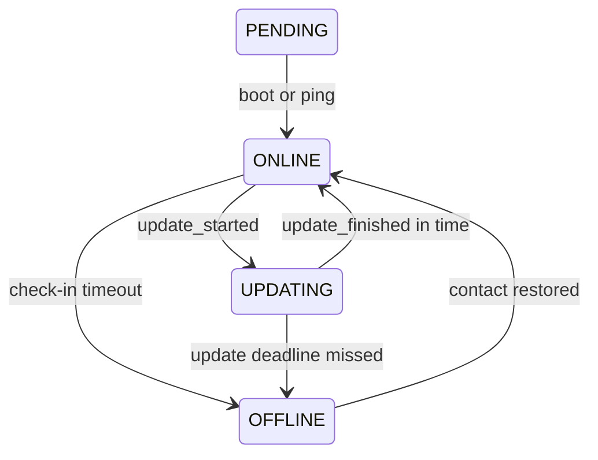

# Electricity Monitor — Project Spec (v2: multi-user platform)

## 1. Goal

Turn [v1](archived/PROJECT_V1.md) into a platform for many users.

Anyone can buy a pre-flashed device from us, or buy their own ESP32-C3
and flash our firmware. They connect it to their home Wi-Fi and get
alerts when their device loses and restores contact. Advanced users get a REST
API, their own Telegram bots, webhooks and more control.

The device pings every 30 s by default. Missing pings indicate a loss of
contact. The device also checks in immediately after boot, as soon as it
can reach the API. The server uses boot information to estimate the cause
of a gap and can record a suspected power blip even if the device never
went offline.

The platform is **free** for all users for now.

## 2. Scope

### In v2

- Own auth: email + password and Google sign-in. Emails sent via
  Resend.
- Many devices per user, each with its own token and settings.
- Sharing a device with family members.
- Easy device setup: pre-flashed device or browser flashing, then Wi-Fi
  and pairing code on the device's own setup page.
- Notifications:
  - Telegram via the **platform bot** (simple, default),
  - Telegram via the **user's own bot** (advanced),
  - **Webhooks** (signed, with retries).
- Public **REST API** with user-generated API tokens and Swagger UI
  backed by a generated OpenAPI document.
- Outage classification:
  - **short** vs **long** interruption, threshold adjustable per device,
  - suspected **power** loss, a **network** interruption, or an **unknown**
    cause, based on boot information and uptime.
- Statistics: number of outages, total / average downtime, availability
  % per day / week / month.
- Separate React apps for users and platform administrators.
- Remote device settings and signed firmware updates over Wi-Fi (OTA).
- Ukrainian, English and Russian translations stored by key in the repo.

### Architecture

- The React client, React admin app, ESP devices and external integrations
  connect to one Node.js/Express API. The API enforces access for each caller.
- PostgreSQL stores accounts, device ownership and sharing, device state and
  settings, outage history, update status and the notification queue.
  [DATABASE.md](DATABASE.md) defines the schema.
- A separate worker uses the same database to detect missed pings, check
  update deadlines and deliver notifications. React apps and devices access
  platform data through the API.

## 3. Auth (custom)

Implemented in our Express server. No third-party auth service; Resend
only sends emails.

### Email + password

- Sign up → verification email (Resend) with a one-time link (valid
  24 h). Account can't add devices until the email is verified. Sign up
  answers `201` with no body and does not sign in: signing in would reveal
  whether the email was new. An existing email gets an "account exists"
  email instead.
- Emails are sent after the response, so response time doesn't reveal
  whether an account exists. A lost email is recovered with resend or
  forgot password.
- Every bad email-link token answers `410 expired`, whether it is unknown,
  used, expired or for another purpose.
- Passwords hashed with **argon2id**.
- Forgot password → reset link by email (valid 1 h, single use). Reset
  logs out all sessions, marks the email verified (the link proves ownership)
  and expires the user's other unused reset links.
- Rate limits on sign up, log in, reset (per IP and per email).

### Google sign-in

- OAuth 2.0 / OpenID Connect, authorization code flow with PKCE.
- Scopes `openid email profile`. The ID token arrives over the TLS back
  channel, so the server decodes it and checks `aud`, `iss` and
  `email_verified`.
- If a user with the same **verified** email exists, Google is linked
  to that account. If the same email belongs to an **unverified** local
  account, Google is linked, the email is marked verified, the password is
  removed and all its sessions are revoked, which blocks pre-registration
  takeover.
- New Google accounts get `uk` / `Europe/Kyiv`; the app can `PATCH /me`
  afterwards.
- The callback redirects to `<app origin>/auth/google`, clean or with
  `?error=`. OAuth state and the PKCE verifier live in a signed 10-minute
  `em_oauth` cookie.
- A user can have both a password and Google linked.
- Client side: the client stores `{ intent, next }` in
  `sessionStorage['em.google']` and navigates to
  `/api/auth/google?app=CLIENT&intent=…`. `/auth/google` shows a translated
  message for `?error=`. Otherwise it uses the refreshed session and goes to
  `next`: `/devices` by default for `LOGIN`, `/account` for `LINK`. A
  Google-only user who gets `reauth_required` on account deletion signs in
  with Google again (`LOGIN`, `next=/account?confirmDelete=1`), and Account
  opens the delete dialog.

### Sessions

- **Access token:** short-lived JWT (15 min), sent as
  `Authorization: Bearer`.
- **Refresh token:** random, 30 days, stored hashed, sent in an
  `httpOnly`, `Secure`, `SameSite=Lax` cookie. Rotated on every use;
  reuse of an old refresh token revokes the whole session. A token reused
  within 10 s of its first use answers `409 conflict` and revokes nothing:
  two tabs refreshing at the same moment, the second one retries once.
- "Log out everywhere" in account settings.
- Use HTTPS custom domains under a shared parent domain for the apps and
  API (see §12). The refresh cookie stays scoped to the API host. Both apps
  send credentialed auth requests, and the API allows credentials only from
  the explicit app origins for that environment.

### Emails (Resend)

- Verify email, reset password, device-sharing invite, "webhook
  disabled" notice.
- Templates in all 3 languages. Choose the language using the recipient's
  profile preference or the default described in §9.

## 4. Device

### Two ways to get a device

1. **Pre-flashed device (we sell it).** Firmware already on it. The user
   only does the setup page step below.
2. **Own ESP32-C3.** The client app has a "Flash firmware" page using
   **ESP Web Tools** (Web Serial, works in Chrome / Edge). The user
   plugs the ESP in via USB and clicks one button — no PlatformIO
   needed.

### Firmware

- **Setup mode (captive portal).** On first boot (or after holding the
  BOOT button for 5 s) the ESP starts its own Wi-Fi network
  `ElecMonitor-XXXX`. The user connects with a phone, a setup page opens,
  and they enter:
  - home Wi-Fi name and password,
  - **pairing code** from the client app.
- On first connect the ESP exchanges the pairing code for its permanent
  **device token** (`POST /api/v1/device/claim`) and stores it in flash.
- The server URL is built into the firmware.

### Monitoring signals

The ESP32-C3 runs from the monitored power supply. It sends two types of
authenticated HTTPS check-in to `POST /api/v1/device/ping`:

| Type   | When                                                                                | What it tells the server                                           |
| ------ | ----------------------------------------------------------------------------------- | ------------------------------------------------------------------ |
| `BOOT` | Immediately after Wi-Fi connects and the API is reachable on each boot              | The device started a new boot session and reports the reset reason |
| `PING` | Every 30 s by default, and promptly after reconnecting within the same boot session | The device is reachable and reports telemetry                      |

```json
{
  "type": "BOOT",
  "boot_id": "b738bb72-4172-4edd-8b30-8d5219d8f5f3",
  "seq": 1,
  "uptime_s": 8,
  "reset_reason": "POWER_ON",
  "rssi": -61,
  "fw": "2.0.0"
}
```

- Generate a fresh `boot_id` in memory on each boot. Include it, the
  increasing `seq`, current `uptime_s`, `rssi` and `fw` on every check-in.
- Read the startup reason using ESP-IDF's `esp_reset_reason()` and include
  it in `BOOT` and `PING` messages. Map power-on, brownout, software,
  watchdog and panic reasons explicitly. Use `UNKNOWN` for unrecognized
  values. See the [ESP32-C3 system API](https://docs.espressif.com/projects/esp-idf/en/release-v5.4/esp32c3/api-reference/system/misc_system_api.html).
- Retry the boot check-in on transient failures with backoff and honor
  `Retry-After`. Keep the same `boot_id` and `seq` on retry and refresh
  telemetry. Send one request at a time. The API returns `204` for a
  successful check-in and acknowledges duplicates without advancing
  last-seen time or duplicating events.
- When power drops and the board shuts down, it stops sending. The server
  detects the silence (§5). If a brief drop resets the board, the next
  boot check-in carries the evidence for a suspected power blip. If the
  power adapter absorbs the dip and the board stays up, this hardware may
  miss it. Direct detection of those dips would need a separate power sensor.

### Wi-Fi disconnect diagnostics

- After the device first gets an IP, log an unexpected Wi-Fi disconnect
  locally with the boot ID, uptime and driver reason code. Coalesce failed
  reconnect attempts into the same interruption. When the device gets an
  IP again, record the recovery uptime and duration. Ignore planned
  disconnects during setup or OTA.
- Keep one in-progress interruption and a fixed ring buffer of 16 completed
  interruptions in RAM. Store the boot ID once and use compact numeric
  fields per record. Budget up to 512 bytes for the 16 completed records.
  If the buffer is full, overwrite the oldest record and increment a
  saturating per-boot eviction counter.
- Send the buffered records and eviction counter with the next successful
  `PING`. On acknowledgement, remove only the records included in that
  request. The server deduplicates by device, boot ID and local event ID
  and keeps the highest reported eviction counter per boot. It stores
  diagnostics even if the device stayed `ONLINE` throughout.
- Skip missed periodic pings and send one fresh `PING` after reconnecting.
  The Wi-Fi buffer and counter reset on reboot or power loss. The server
  keeps diagnostics it has already received.
- A failed HTTPS request with Wi-Fi still connected is an API reachability
  failure. Preserve that distinction in the device diagnostics.

### Flash storage

- Store Wi-Fi credentials, the device token, applied settings and the
  current OTA attempt or unacknowledged OTA result in non-volatile storage
  (NVS). Write on configuration changes or OTA state changes. Regular
  pings and Wi-Fi diagnostic records do not write to flash.
- Stream the firmware download in bounded chunks to the inactive OTA
  flash partition. The full image does not need to fit in RAM.

### Remote configuration

The owner saves changes in the client app. The API stores the desired
settings in PostgreSQL. On its next check-in, the ESP fetches the current
settings and reports what it applied. The client app shows pending and
applied changes. Changes for an offline device wait for reconnection.

The ping interval defaults to 30 s and can be changed by the owner. The
server validates it against both the ping rate limit and the offline
timeout. Until the device confirms the change, the server allows for both
the previous and the new interval when checking for missed pings: the
deadline is the later of the offline timeout and twice the previous
interval. Server settings such as notification rules and the offline
timeout apply as soon as they are saved.

### Firmware distribution and OTA updates

Keep the firmware source private. A pre-flashed board ships with the
firmware installed. A user flashing their own board downloads the compiled
image in the browser. The initial firmware supports OTA so later releases
can be installed over Wi-Fi. Remote settings take effect independently of
firmware releases.

#### Update discovery and installation policy

- The platform publishes a compatible signed release. The device checks
  for pending updates on first contact after boot or reconnect and then
  roughly once an hour, with jitter and backoff. The device makes each
  request to the API.
- **Manual by default.** The owner sees **Update available** in the client
  app and selects **Install**. The server queues the requested version.
  While the command is pending, the API includes
  `X-Firmware-Update: pending` in its `204` ping response to trigger an
  immediate update check. A command for an offline device waits until it
  reconnects. Checking for a release or waiting for an install command
  leaves normal pings running.
- **Automatic OTA (opt-in per device).** The owner enables automatic
  installation of compatible stable releases. The server offers an
  eligible release on the next firmware check, without an Install click.
  Both modes use the same update flow. A failed or timed-out release
  requires a new explicit retry before that version is attempted again.

#### Update signals and maintenance window

1. The device saves the attempt ID across reboot and sends `update_started`
   with the target version. The API confirms a bounded update window for
   an online device. Retries reuse the attempt ID and original deadline.
   The device starts installation only after receiving an unexpired
   confirmation.
2. The device pauses `PING` while it downloads the signed image over HTTPS,
   writes it to the inactive slot, verifies it before switching slots, and
   reboots. The apps show `UPDATING`. The worker excludes the planned gap
   from outage notifications and statistics.
3. After local startup checks, the device confirms the new firmware or
   rolls back. As soon as it can reach the API, it sends `update_finished`
   with the attempt ID, outcome (`SUCCEEDED`, `FAILED` or `ROLLED_BACK`),
   running version and boot ID. A download or verification failure reports
   `FAILED` while the old firmware is still running. The device keeps the
   result across reboot until acknowledged. Retrying a result cannot
   create a second state change or notification.
4. `update_started` and `update_finished` are separate API requests.
   Neither advances the last ping timestamp. A result received before the
   deadline closes the maintenance window and returns the device to
   `ONLINE`, with a fresh offline timeout for the next monitoring signal.
   The device then sends its normal `BOOT` after reboot or a `PING` if it
   never rebooted. The reported OTA boot establishes the new boot baseline
   so the reboot does not register as a power blip.
5. If no result arrives by the deadline, the device goes `OFFLINE`, the
   user receives an update-specific notification, and unplanned downtime
   starts at the deadline. A late result can record the outcome and close
   the matching outage without removing the recorded downtime or changing
   a newer attempt. A normal `BOOT` or `PING` after expiry can also restore
   contact if the result is unavailable.

### Adding a device (user flow)

1. Client app → "Add device" → enter a name ("Home", "Dacha").
2. Server creates the device and shows a **pairing code** (8 chars,
   valid 30 min, single use). An owner can have up to 20 devices.
3. Own ESP only: flash the firmware.
4. User enters Wi-Fi + pairing code on the ESP's setup page.
5. ESP claims the code → gets a device token → starts pinging.
6. Client app shows the device as 🟢 ONLINE.

## 5. Device state machine



- `PENDING`: created, never pinged.
- Claiming a pairing code (also when re-pairing) clears the known boot
  ID. The next boot then has no boot evidence: no power blip, and cause
  `UNKNOWN` if it ends an outage.
- On the first check-in, start monitoring silently. On later accepted
  check-ins, compare the previous check-in and current boot data before
  updating last seen. If the device was `OFFLINE`, close the open outage.
- If contact returns after the timeout but before the worker's next check,
  record the completed outage in the check-in transaction. Send one
  summary under the notification rules below because no live OFF alert
  was queued. The device stays `ONLINE`, and its "state since" time
  restarts at the recovery check-in, as after `OFFLINE` → `ONLINE`.
- `UPDATING` is shown while a confirmed OTA window is active. An ordinary
  check-in cannot end this state. The API and worker both apply the OTA
  deadline rules in §4 before processing recovery.
- The worker checks every 10 s. An `ONLINE` device goes `OFFLINE` after
  `offline_timeout` (default 120 s) since the last accepted check-in or
  the end of the OTA window reported by `update_finished`, whichever is
  later. The worker opens an outage and queues any due notification. The
  device's "state since" time is the missed deadline, not the time the
  worker ran.
  Check-in, OTA and worker handlers lock the same device row when writing
  state, outages and queue entries. The worker skips rows already locked
  by another transaction.

**State lives in the DB**, not in memory (unlike v1). Any server
instance can handle any ping; restarts lose nothing.

### Outage classification

Use the following evidence when contact resumes. Apply the OTA rules in
§4 first. An outage opened at a missed OTA deadline keeps cause `UNKNOWN`.

| Evidence                                                          | Cause                                                                                                                                                                                                                                                                                  |
| ----------------------------------------------------------------- | -------------------------------------------------------------------------------------------------------------------------------------------------------------------------------------------------------------------------------------------------------------------------------------- |
| Previously known `boot_id` changed, with `POWER_ON` or `BROWNOUT` | `POWER` (suspected power interruption)                                                                                                                                                                                                                                                 |
| Same `boot_id` across an offline gap                              | `NETWORK` (the device stayed up, but the Wi-Fi, internet or API path was unavailable). An overlapping Wi-Fi diagnostic confirms a local disconnect occurred during the gap. It does not change the cause and is not stored on the outage. The owner sees it in the device diagnostics. |
| Software, watchdog, panic, unknown reset or missing boot evidence | `UNKNOWN`                                                                                                                                                                                                                                                                              |

For an outage or power blip, measure the observed contact gap from the
last accepted check-in before the interruption to the recovery check-in.
An expired OTA window uses its deadline as the start. Classify the gap
as `SHORT` when it is below the device's short-outage threshold (default
3 min) and `LONG` otherwise. The gap is an estimate for display and stats.
It includes time spent booting and reconnecting. The exact duration of
power loss is unavailable.

### Power blips before the offline timeout

When an `ONLINE` device reports a new boot with a `POWER` cause before
the offline timeout, record a completed suspected power blip and keep
the device `ONLINE`. Include it once in history and statistics. Apply
the same duration classification to the observed gap. A software,
watchdog or panic reset before the offline timeout does not create a
power blip.

- Example: the device sends a `PING`, the power flickers 10 s later,
  and the device sends its boot check-in 15 s after that. With the default
  settings, it stays online and its history shows a suspected short power
  interruption with a 25 s contact gap.
- If Wi-Fi or the router takes longer to return, the same flicker can
  produce an offline alert. The subsequent boot check-in can suggest a
  power interruption, but it cannot tell how long the power was out.

### Device settings

- Name.
- Ping interval (30 s by default), applied by the device.
- Automatic firmware updates (off by default).
- Offline timeout (default 120 s).
- Short-outage threshold (default 3 min).
- Notify on short outages:
  - if off, queue the OFF alert once both the offline timeout and the
    short-outage threshold have elapsed. Store shorter interruptions
    silently.
  - for a completed interruption with no queued OFF alert, send at most
    one summary. Apply the short-outage setting to `SHORT` events and
    the suspected network setting to `NETWORK` events.
- Notify on suspected network outages. The cause is estimated once the
  device reconnects, so this setting affects summaries only. A recovery
  message always follows an OFF alert.
- Quiet hours (optional): messages are sent silently
  (Telegram `disable_notification`). The window is read in each
  recipient's timezone.
- These rules belong to the device and are set by the owner. Every
  recipient of the device's alerts follows them. Only quiet hours differ
  per recipient, through the timezone.

### Monitoring acceptance checks

- Use a controlled clock to cover first boot, regular pings, sustained loss
  of contact, recovery before the next worker check, a power reset before
  the timeout, a Wi-Fi-only interruption, a software reset, duplicate
  check-ins. For OTA, cover successful installation,
  rollback, duplicate start and result requests, and a result arriving
  after the deadline. Verify that OTA reports never update the last ping
  timestamp and that a planned reboot creates no power blip.
- On the target ESP32-C3 and power adapter, verify the reset reasons and
  boot check-in for brief and sustained power interruptions. Repeat with
  the router restarting and with only Wi-Fi interrupted.
- Simulate an extended API outage and more than 16 Wi-Fi interruptions.
  Verify that buffer capacity stays fixed, the newest records survive,
  the eviction count is reported and retries do not duplicate diagnostics.
  Check available heap on the target board during reconnect and OTA.

## 6. Sharing a device

- The owner invites a person by email (Resend sends the invite link).
- Roles:
  - **Owner** — full control, one per device.
  - **Viewer** — sees status, outages and stats; connects **their own**
    notification channels to the device; can't change settings, re-pair
    or delete.
- The owner can remove a viewer at any time. A viewer can leave.
- Invite valid 7 days. If the person has no account, they sign up
  first, then the invite is applied.

## 7. Notifications

Each user has **channels** (platform Telegram, own bot, webhook) and
chooses which devices notify which channels. All sends go through a
queue (a Postgres table) processed by the worker, with a delivery log.
Viber is a candidate for a future notification channel and would follow
the same localization rules.

### Telegram — platform bot (default)

1. Client app → "Connect Telegram" → link
   `https://t.me/<PlatformBot>?start=<link_code>`.
2. User presses **Start** in Telegram.
3. Bot receives `/start <link_code>` (via Telegram webhook to our API)
   and saves the `chat_id` as a new channel.
4. Works for private chats and groups (`startgroup` link). The new
   channel is attached to every device the user owns at that moment, and
   the user can change that per device. Devices created later aren't
   attached automatically.

Bot commands: `/status` (devices that notify this chat), `/stats`
(last 7 days, with statistics), `/stop` (unlink the chat). Removing the bot
from a group also unlinks it. Linking creates a channel named after the
group title or the person's Telegram name. Linking a chat that is already
linked changes nothing.

### Telegram — user's own bot (advanced)

- User creates a bot with `@BotFather`, pastes the bot token and
  `chat_id` in the client app.
- Server checks the token (`getMe`) and sends a test message.
- Bot token is stored **encrypted** (AES-256-GCM, key in env).

### Webhooks

- User adds a URL and selects events (`device.offline`, `device.online`,
  `device.power_blip`). Send `device.power_blip` for a completed suspected
  power blip while still online. Use `device.online` with completed outage
  details for other completed interruptions. Send these events according
  to the notification rules in §5.
- Request:
  ```
  POST <user url>
  Content-Type: application/json
  X-Elec-Event: device.offline
  X-Elec-Delivery: <delivery id>
  X-Elec-Signature: sha256=<HMAC of body with webhook secret>

  {
    "event": "device.offline",
    "device": {"id": "...", "name": "Home"},
    "outage": {"id": 123, "started_at": "...", "ended_at": null,
               "duration_s": null, "cause": null, "kind": null},
    "sent_at": "..."
  }
  ```
- Success = any `2xx` within 10 s.
- Retries with backoff: 1 min, 5 min, 30 min, 2 h, 6 h → then `FAILED`.
- After 20 failures in a row the webhook is disabled and the user gets
  an email.
- "Send test" and "Redeliver" buttons in the client app.
- **SSRF protection:** only `https`, no private / localhost / link-local
  IPs (checked after DNS resolve).

### Message texts

Same as v1, plus device name and classification:

```
🔴 Home — device stopped checking in
Last signal: 21 Nov 18:42

🟢 Home — device is back online
Offline for 2 h 15 min (18:42 → 20:57) · suspected power outage

🟡 Home — suspected short power interruption
Device restarted · 25 s between check-ins
```

- A completed interruption with no OFF alert sends a summary instead:
  `🟠 Home — device was out of contact`, with the same body as the 🟢
  message. A `LONG` power blip drops "short" from its title.
- Times use the recipient's timezone, as `21 Nov 18:42`. A range on one
  local day shows times only (`18:42 → 20:57`), otherwise both dates.
  Durations are floored: `25 s`, `12 min`, `2 h 15 min`, `1 d 3 h`.
- Telegram messages are plain text (no `parse_mode`), so device names need
  no escaping.

Render human-readable notifications in the recipient's preferred language
and timezone. For a shared device, each recipient gets messages according
to their own profile, regardless of the device owner's preferences. This
also applies to Telegram bot replies and transactional emails.

Keep webhook fields, event names, status and error codes, and timestamps
in their documented machine-readable formats across all languages.

## 8. API

[API.md](API.md) defines every endpoint: device, auth, client and public
REST, admin, Telegram webhook, health and docs. It also covers auth,
errors, rate limits, and request and response shapes.

- One Express API serves devices, both React apps and scripts.
- The client app and scripts use the same `/api/v1` endpoints, with an
  access JWT or an API token.
- Device endpoints, including the check-in, live under `/api/v1/device/*`.
- The server generates the public OpenAPI document from its schemas and
  serves it through Swagger UI.

## 9. Client app (React)

Vite + React + TypeScript, React Router, TanStack Query, shadcn/ui
components on Tailwind CSS, forms with React Hook Form and Zod, and
i18next for translations. All data goes through our API. Colors and the
light, dark and system themes follow [theme.md](theme.md).

Polling pauses in hidden tabs: devices list every 30 s, device page every
15 s, add-device wizard every 3 s while the device is `PENDING`, Telegram
connect every 3 s until a new channel appears or the link expires.

Pages:

- **Sign up / Log in / Google sign-in / Verify email / Reset password**
- **Devices** — cards with 🟢 / 🔴 / ⚪, "since", last seen; shared
  devices marked.
- **Device** — status, timeline of outages, stats (day / week / month),
  settings and their applied status, firmware version, update availability,
  Install button, automatic update setting, queued and running updates,
  update result, members & invites, channels, "re-pair", "rotate token",
  "delete".
- **Add device** — wizard: name → pairing code → (flash) → wait for
  first ping.
- **Flash firmware** — ESP Web Tools.
- **Notifications** — connect platform Telegram bot, add own bot, add
  webhook, delivery log.
- **API tokens** — create (shown once), list, revoke.
- **API docs** — Swagger UI backed by the generated OpenAPI document.
- **Account** — name, timezone, language, linked Google, log out
  everywhere, delete account.

### Device settings and owner actions in the client

- Ping interval and offline timeout are entered in seconds. The
  short-outage threshold is entered in whole minutes (1–1440) and sent in
  seconds. The form sends only the fields that changed. It checks that the
  offline timeout is at least 2 × the ping interval before submitting and
  shows the same `too_small` message as the server. `auto_update` stays
  hidden until M11. While `settings_sync.pending` is true, the form shows
  "Waiting for the device to apply" in the warning color.
- Settings, re-pair, rotate token and delete render only for the device's
  owner. The timeline and the device's channel choice show for every role.
  The server still enforces access.

### Admin app (React)

A separate app for platform staff uses the same stack as the client app
and the same Express API. Admin routes
require a signed-in account with a platform administrator role checked by
the server. The initial app is read-only and shows:

- Platform health, API errors and background worker status.
- Device counts by state and a searchable device list with last check-in,
  firmware version and update result.
- Notification queue depth and recent delivery failures.

### Localization

Keep keyed dictionaries for Ukrainian (`uk`), English (`en`) and Russian
(`ru`) in the `shared/` workspace. Load them with i18next in both React apps and
on the server for generated messages, including emails and Telegram
notifications. Translations ship
with the app and server releases.

Store each account's preferred `language` in its PostgreSQL profile.
`GET /api/v1/me` returns it and `PATCH /api/v1/me` validates and saves
changes from Account settings. Both React apps use the saved preference
after sign-in. The server uses it when rendering outgoing messages as
described in §7. If a recipient has no saved preference, use Ukrainian
(`uk`), including invites sent to people without an account.

In the client, the UI language is the account's `language` when signed in.
When signed out it is `localStorage['em.language']`, then the first of
`navigator.languages` whose prefix is `uk`, `en` or `ru`, then `uk`. The
switcher on signed-out pages writes `localStorage`; when signed in it also
sends `PATCH /me`. Sign-up sends the current UI language and the browser
timezone (`Europe/Kyiv` if unknown). Form validation messages come from the
shared Zod schemas through the `app.validation.*` keys.

## 10. Security

- HTTPS everywhere, including the API on EC2 and the Vercel apps.
- Passwords: argon2id. Email verification required.
- Refresh tokens rotated with reuse detection; access JWT 15 min.
- Device tokens, API tokens, refresh tokens: random 32 bytes, only
  SHA-256 hash stored. API tokens have a prefix (`em_live_`) so leaked
  tokens are easy to find.
- Bot tokens and webhook secrets encrypted at rest (AES-256-GCM).
- Every query checks the user's access (owner / viewer); tests check
  that user A can't read user B's data.
- Supabase Row Level Security turned **on** for all tables with no
  public policies, so the anon key can't read anything. Only our server
  talks to the DB.
- Webhook SSRF protection (see §7).
- Account deletion removes all owned devices, outages, channels, tokens,
  and memberships.

## 11. Scale

Rough numbers to plan for:

- 1 000 devices × 1 ping / 30 s ≈ **33 pings/s** → one small `UPDATE`
  each. Fine for one server instance and Supabase.
- 10 000 devices ≈ 330 pings/s → need several server instances and to
  check DB load. If needed, last-seen times can move to Redis later.
- A **mass outage** (a whole district goes dark) creates many
  notifications at once. They go through the queue, and the worker
  respects Telegram limits (~30 msg/s per bot).

## 12. Deployment

| What       | Where                                                |
| ---------- | ---------------------------------------------------- |
| API        | AWS EC2, `systemd` service behind Caddy              |
| Worker     | AWS EC2, separate `systemd` service on the same host |
| Client app | Vercel                                               |
| Admin app  | Vercel (separate project)                            |
| Database   | Supabase (Postgres)                                  |
| Emails     | Resend                                               |

- The worker runs two loops in one process: a 10 s monitor loop (offline
  check, OFF alerts, cleanup) and a delivery loop that sends Telegram
  messages and webhooks. Each loop has its own `worker_heartbeat` row
  (`main`, `delivery`).
  Start with one worker instance. Persist the delivery ID across retries
  so webhook consumers can deduplicate uncertain deliveries. The API can
  scale to several instances.
- API and worker share one codebase. Run both directly with Node.js 26 LTS
  on EC2. The initial staging deployment uses `systemd` and Caddy.
- Each React app has its own Vercel project rooted at `client/` or
  `admin/`. Configure the SPA fallback to `index.html` for React Router
  deep links; `client/vercel.json` rewrites every path to `/index.html`
  (static files are served first). The manual steps are in
  [deploy/README.md](../deploy/README.md#client-app-on-vercel).
- The client's only build-time setting is `VITE_API_URL`, the API origin.
  Preview builds and the `v2` branch use the staging API
  (`https://staging-api.<domain>`); the `v2` branch is served at
  `https://staging-app.<domain>`. Preview `*.vercel.app` URLs can't sign
  in, because CORS and the refresh cookie allow only the stable origins.
- The parent domain `<domain>` is `elec-monitoring.homes`.
- Custom domains in production: the client app on the apex `https://<domain>`,
  `https://admin.<domain>` and `https://api.<domain>`; `www.<domain>`
  redirects to the apex. Staging: `staging-app.<domain>`,
  `staging-admin.<domain>` and `staging-api.<domain>`. Use these custom
  domains for browser sign-in and refresh so the app and API are same-site.
- Supabase: use the pooler connection string.
- Keep staging and production separate. Staging uses its own API,
  worker, database, auth secrets and integration credentials. Assign
  stable staging app and API domains under the same parent domain for
  sign-in and refresh testing. Vercel preview builds use the staging API
  configuration. Run authenticated smoke tests from the stable staging
  origins.
- Access the database with Drizzle ORM. Generate migrations as SQL files
  in `server/` with Drizzle Kit and review them before merge. Run them once per
  environment before the API and worker roll forward. Use migrations
  compatible with the old service versions during a rolling deploy.
- Telegram platform bot webhook points to
  `https://api.<domain>/telegram/webhook/<secret>`. Register it once per
  environment from `server/` with
  `npm run telegram:webhook -- set` (and `info`, `delete`).

### EC2 staging setup

The commands live in [deploy/README.md](../deploy/README.md), and the
Caddy, `systemd` and env templates are in `deploy/`.

1. Host: `elec-staging` in Stockholm (`eu-north-1`), the same region as
   the Supabase staging project. Ubuntu Server 26.04 LTS ARM64 on
   `t4g.small` (2 GiB RAM plus a 2 GiB swap file), 20 GiB encrypted
   `gp3` root volume. The security group allows SSH `22` from the
   operator's IP and public TCP `80` and `443` for Caddy only.
2. Domain `elec-monitoring.homes`, DNS at Porkbun. An Elastic IP is
   associated with the instance, and the `staging-api` `A` record points
   to it. Caddy serves that hostname with automatic HTTPS and proxies to
   `127.0.0.1:3000`. The API listens on `HOST=127.0.0.1`, so its port is
   closed even if the security group is wrong.
3. Node.js 26 LTS from NodeSource at `/usr/bin/node`. The `v2` checkout
   lives in `/opt/elec/staging`, owned by `ubuntu`. Each release is built
   by `ubuntu` in its own directory under `/opt/elec/staging-releases/`,
   and `/opt/elec/staging-current` links to the running one.
4. Settings live in `/etc/elec/staging.env` (`root:root`, `0600`), in
   `systemd` env-file syntax: double-quote values with spaces. Staging
   uses its own `JWT_SECRET`, Google OAuth client, Resend key and
   Supabase session pooler URL (IPv4, port `5432`), with `PORT=3000` and
   `TRUST_PROXY_HOPS=1` because Caddy is the only proxy.
5. `elec-staging-api.service` and `elec-staging-worker.service` run
   `node dist/api.js` and `node dist/worker.js` directly (not through
   `npm`, so signals reach Node and the service user needs no home) as
   the unprivileged system user `elec`, with
   `WorkingDirectory=/opt/elec/staging-current/server`, the env file and
   `Restart=always`. Both start at boot.
6. Each release runs `deploy/staging-release.sh` under one lock, from the
   auto-deploy timer or by hand over SSH: fetch `v2`, export the commit into a new release
   directory, `npm ci`, build, run `node dist/db/migrate.js` from the new
   build once as `elec` through `systemd-run`, switch
   `staging-current`, restart both services and check they are active. A
   failed step before the switch leaves the running release untouched.
7. Staging is up when `https://staging-api.elec-monitoring.homes/health`
   returns `200`, `worker_heartbeat.beat_at` advances, `journalctl` shows
   no startup errors, and port `3000` is unreachable from outside.

For production, use its own checkout, `/etc/elec/production.env`, API and
worker services, Supabase project, and credentials. If both environments
share one EC2, move staging to port `3001`, keep production on `3000`, and
route the two hostnames in Caddy. A shared host outage affects both
environments. A separate `elec-production` instance gives production its
own host and Elastic IP.

### CI/CD

- Set up GitHub Actions as part of the V2 foundation. Run checks on pull
  requests and deploy branches. Require successful checks before merge.
- Run `npm ci`, lint and formatting checks, TypeScript checks and builds
  for the server and both React apps, Vitest for the API and worker,
  and an ESP32-C3 firmware build as each package is added.
- Deploy to staging after CI passes. Set up EC2 and perform the first
  release manually. A systemd timer on EC2 then checks the tip of `v2`
  every 15 minutes and deploys it after GitHub Actions reports a
  successful push run for that SHA. The release skips a commit that is
  already running or is no longer the tip, and the timer does not retry
  a commit whose release failed. It checks both services and
  the public health endpoint. Setup is in
  [deploy/README.md](../deploy/README.md#continuous-deployment).
  Verify the API health endpoint, worker heartbeat, auth refresh, a
  device check-in and a client deep link as those features land. Gate
  production releases on passing CI and staging smoke tests.
- Keep deployment credentials in CI or provider secrets. Set the API base
  URL per Vercel environment. Browser builds contain public config only.

### Config (environment variables)

```
DATABASE_URL=...
JWT_SECRET=...                     # at least 32 characters
ENCRYPTION_KEY=...                 # 32 bytes, base64 (M8)
GOOGLE_CLIENT_ID=...
GOOGLE_CLIENT_SECRET=...
EMAIL_TRANSPORT=resend             # resend (default) | log
RESEND_API_KEY=...                 # required when EMAIL_TRANSPORT=resend
EMAIL_FROM=...
TELEGRAM_PLATFORM_BOT_TOKEN=...    # worker only
TELEGRAM_PLATFORM_BOT_USERNAME=... # API, without @
TELEGRAM_WEBHOOK_SECRET=...        # API, 32-256 chars of A-Z a-z 0-9 _ -
TELEGRAM_TRANSPORT=telegram        # worker; telegram (default) | log
CLIENT_URL=https://<domain>        # origin only, no path
ADMIN_URL=https://admin.<domain>
API_URL=https://api.<domain>
TRUST_PROXY_HOPS=0                 # 1 when Caddy is the only proxy
PORT=3000
HOST=127.0.0.1                     # optional; unset listens on all interfaces
```

The worker reads `DATABASE_URL`, `TELEGRAM_PLATFORM_BOT_TOKEN` and
`TELEGRAM_TRANSPORT` (`telegram` default | `log`, which only logs messages
for local runs; the token is required when `telegram`). The API doesn't
need the bot token.

The API validates these with Zod at startup and exits on a missing or
invalid value. App URLs must be origins: `https`, or `http` for
`localhost` and `127.0.0.1`; a trailing slash is removed. The worker and
`db:migrate` need only `DATABASE_URL`. Each milestone adds its keys when
its code first reads them.

## 13. Repo layout

```
elec-monitoring/
  docs/
    archived/
  firmware/
  server/
  client/
  admin/
  shared/      # npm workspace: translations, enums and API schemas (@elec/shared/api)
```

## 14. Milestones

[ROADMAP.md](ROADMAP.md) tracks progress and lists each milestone's
deliverables and acceptance checks.

Every milestone adds its CI checks, its access tests and its translations
as the implementation lands. From M4 on, each milestone includes its
client UI.

- **M0 Foundation:** server and worker skeleton, schema and migrations,
  CI, i18n, OpenAPI registry.
- **M1 Auth:** email + password, email verification and reset (Resend),
  Google sign-in, sessions, auth rate limits, staging environment.
- **M2 Devices:** CRUD, `BOOT` and `PING`, Wi-Fi diagnostics, state in DB.
- **M3 Worker:** checker, outages, power blips, classification, platform
  Telegram bot.
- **M4 Client app:** log in, devices list, device page, add-device flow.
- **M5 Firmware and device setup:** check-ins, Wi-Fi diagnostics, captive
  portal, pairing code, browser flashing. The first firmware already has
  the OTA partition layout and verifying key.
- **M6 Sharing:** invites, viewer role.
- **M7 API integrations:** API tokens, public REST API, complete OpenAPI
  document and Swagger UI.
- **M8 Own Telegram bot + webhooks** with delivery log and retries.
- **M9 Statistics** in API, client app and `/stats` bot command.
- **M10 Admin app:** read-only monitoring of the API, worker, devices and
  notification queue.
- **M11 Remote device management:** settings sync, signed manual and
  automatic OTA, separate update signals, rollback and maintenance
  monitoring.
- **M12 Launch readiness:** rate limit and access audits, translation
  review, EC2 and Vercel production releases, smoke tests.

No device goes to a user before M11 is done, because the first firmware
must support OTA (§4).
